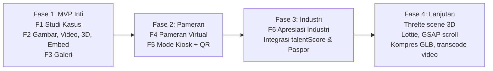

# Skill-Hub: Portal Portofolio Interaktif & Pameran Karya Siswa

> Status: **Draf rencana** — dikembangkan dari ide di Inbox. Modul ini dibangun di atas codebase VOC-Market yang sudah ada (Bun + ElysiaJS + Svelte 5 + MySQL/Drizzle), **bukan** proyek baru.

---

## 1. Deskripsi Ide

Siswa SMK dituntut menghasilkan karya nyata. Skill-Hub adalah **ruang pameran digital** tempat siswa mengunggah dan mendemonstrasikan proyek akhir, prototipe aplikasi, atau karya desain — lengkap dengan render 3D yang bisa diputar, animasi web, video proses, dan demo aplikasi yang bisa langsung dicoba.

**Masalah yang diselesaikan**

| Pihak | Masalah sekarang | Setelah ada Skill-Hub |
|---|---|---|
| Siswa | Karya hanya jadi nilai di rapor, lalu hilang | Karya punya halaman permanen yang bisa dibagikan & dilampirkan saat melamar |
| Guru / Sekolah | Sulit memamerkan hasil praktik ke industri dan orang tua | Ada galeri terkurasi + Mode Pameran untuk layar TV saat kunjungan industri |
| Industri | Menilai kemampuan siswa hanya dari CV/nilai | Bisa melihat proses kerja, mencoba demo, lalu langsung mengundang siswa |

## 2. Nilai Tambah

- Jauh lebih interaktif dibandingkan sekadar angka di buku rapor.
- Menjadi daya tarik saat sekolah dikunjungi pihak industri (Mode Pameran / Kiosk).
- **Terhubung dengan fitur yang sudah ada**: karya yang diverifikasi guru → masuk Paspor Kerja → meningkatkan `talentScore` → terlihat oleh perusahaan di Cari Talenta → Undangan Industri.
- Bukti kompetensi bisa diverifikasi (QR + stempel guru), bukan sekadar klaim.

## 3. Posisi Terhadap VOC-Market

Skill-Hub **bukan aplikasi terpisah**. VOC-Market sudah punya fondasinya:

| Sudah ada di VOC-Market | Dipakai ulang untuk Skill-Hub |
|---|---|
| `products.type = 'portfolio'` + `projectLink` | Basis entitas "Proyek" |
| Verifikasi guru (`isVerifiedByTeacher`, `teacherNote`) | Kurasi & stempel karya |
| Paspor Kerja + QR SVG | Ringkasan portofolio siswa |
| Etalase SMK / TeFa (`schools`) | Galeri per sekolah & jurusan |
| Level Kreator & Lencana | Gamifikasi unggah karya |
| Kartu OG WhatsApp 1200×630 | Kartu bagikan karya |
| Talent Search + Hiring Invitation | Jalur dari "lihat karya" → "undang siswa" |

Yang **belum ada** (inti dari rencana ini): media kaya (3D/video/animasi/demo), studi kasus terstruktur, pameran virtual, mode kiosk, dan umpan balik industri.

> **Catatan teknologi:** Ide awal menyebut Next.js. Rekomendasinya **tetap di Svelte 5 + ElysiaJS** — seluruh auth, keamanan (XSS filter, rate limiter, session), Docker, dan 25 test sudah dibangun di stack ini. Pindah ke Next.js berarti menulis ulang semuanya tanpa manfaat berarti untuk fitur pameran.

---

## 4. Fitur Inti (MVP)

### F1 — Halaman Proyek Studi Kasus
Halaman detail khusus untuk `type = 'portfolio'`, dengan struktur cerita:
1. **Hero**: judul, tagline, media utama (3D / video / gambar), jurusan, tim.
2. **Masalah** — apa yang ingin diselesaikan.
3. **Proses** — tahapan kerja + galeri foto/video proses.
4. **Hasil** — demo, render akhir, tautan.
5. **Peran & Alat** — peran siswa di tim, software/alat yang dipakai (tag keahlian).
6. **Stempel Guru** — catatan & tanda verifikasi.

### F2 — Media Interaktif (multi-media per proyek)
| Jenis | Format | Penampil |
|---|---|---|
| Gambar | JPG/PNG → WebP (sudah ada via `sharp`) | Galeri + lightbox |
| Video | MP4/WebM, maks ±50 MB | `<video>` native + poster |
| Model 3D | `.glb` (glTF biner), maks ±20 MB | `<model-viewer>` — putar, zoom, AR di HP |
| Animasi | Lottie `.json` / `.lottie` | dotLottie player |
| Demo Web | URL eksternal (Vercel, Netlify, GitHub Pages, itch.io) | `<iframe sandbox>` dengan allowlist domain |
| Embed | YouTube, Figma, Sketchfab, Canva | Embed resmi dengan allowlist |
| Dokumen | PDF (laporan, desain teknik) | Pratinjau halaman pertama + unduh |

### F3 — Galeri Pameran
- Grid karya dengan filter: jurusan (RPL, TKJ, DKV, Animasi, Teknik Mesin, Tata Boga, dll.), jenis media, sekolah, terverifikasi.
- Urutan: Terbaru, Terpopuler, Pilihan Guru.
- Kartu karya menampilkan preview bergerak (video muted loop / poster 3D) saat di-hover.

### F4 — Pameran Virtual (Exhibition)
- Guru / admin sekolah membuat "acara pameran" (mis. *Pameran Karya RPL 2026*), dengan periode, tema, dan daftar karya terkurasi.
- Halaman pameran punya URL sendiri, bisa dibagikan ke orang tua & industri.

### F5 — Mode Pameran / Kiosk
- Tampilan layar penuh untuk TV/proyektor saat kunjungan industri.
- Auto-slide antar karya (interval bisa diatur), model 3D berputar otomatis.
- Setiap slide menampilkan **QR** ke halaman proyek, supaya tamu bisa membuka di HP.
- Tanpa navigasi/login; keluar dengan tombol tersembunyi atau `Esc`.

### F6 — Umpan Balik & Apresiasi Industri
- Akun perusahaan terverifikasi bisa memberi **apresiasi** (mis. "Siap Industri", "Kreatif", "Teknis Kuat") dan komentar singkat.
- Apresiasi tampil di halaman proyek dan Paspor Kerja; menambah `talentScore`.
- Tombol "Undang Siswa Ini" langsung terhubung ke alur Undangan Industri yang sudah ada.

---

## 5. Riset Teknologi Animasi Web & 3D

| Kebutuhan | Pilihan | Alasan | Catatan |
|---|---|---|---|
| Menampilkan model 3D | **`@google/model-viewer`** (web component) | Cukup satu tag HTML, mendukung kontrol putar/zoom, poster, lazy-load, AR (Scene Viewer di Android, Quick Look di iOS jika ada `.usdz`) | Paling cocok untuk MVP — tanpa menulis kode 3D |
| Scene 3D kustom (hero, pameran 3D) | **Threlte** (Three.js untuk Svelte) | Deklaratif ala komponen Svelte | Untuk fase lanjut; bundle lebih besar, muat secara dinamis (`import()`) |
| Kompres model 3D di server | **glTF-Transform** (`@gltf-transform/core` + `functions`) | Bisa dijalankan di Bun: validasi, `dedup`, `prune`, kompres tekstur & geometri | Menurunkan ukuran file sebelum disajikan |
| Animasi ilustrasi | **dotLottie** (`@lottiefiles/dotlottie-web`) | Animasi vektor ringan dari After Effects / LottieFiles | Cocok untuk siswa DKV / Animasi |
| Animasi antarmuka & scroll | **Svelte transitions** bawaan; **GSAP** bila butuh timeline/scroll kompleks | Svelte transition sudah cukup untuk MVP | Hormati `prefers-reduced-motion` |
| Demo aplikasi web | `<iframe sandbox="allow-scripts allow-same-origin">` + allowlist domain | Siswa hosting sendiri, kita hanya menampilkan | Tidak pernah menjalankan kode siswa di origin VOC-Market |
| Video | `<video>` native, poster dibuat dari frame awal | Cukup untuk MVP | HLS/transcode bisa ditambah nanti (ffmpeg di worker) |

**Rekomendasi MVP:** `model-viewer` + dotLottie + Svelte transitions. Threlte dan GSAP ditunda ke fase lanjut.

### Pertimbangan keamanan media
- Validasi file berdasarkan **magic bytes**, bukan hanya ekstensi (`.glb` diawali `glTF`, Lottie divalidasi sebagai JSON terstruktur).
- Batas ukuran per jenis + kuota per siswa.
- Embed & iframe hanya dari **allowlist domain**; CSP `frame-src` diperbarui sesuai allowlist.
- Tidak menerima HTML/JS mentah dari siswa (mencegah XSS — sejalan dengan filter XSS yang sudah ada).
- File SVG tidak diizinkan sebagai media (bisa berisi skrip).

---

## 6. Rancangan Data (Drizzle / MySQL)

Tabel `products` tetap dipakai sebagai entitas proyek. Tambahan:

```ts
// project_details — 1:1 dengan products (type = 'portfolio')
projectDetails = mysqlTable('project_details', {
  productId:   bigint (PK, FK products.id, cascade),
  tagline:     varchar(160),
  major:       varchar(60),          // jurusan: RPL, DKV, TKJ, ...
  problem:     text,
  process:     text,
  result:      text,
  role:        varchar(120),         // peran siswa dalam tim
  tools:       json<string[]>,       // ["Blender", "Figma", "Laravel"]
  teamMembers: json<{ userId?: number; name: string; role: string }[]>,
  coverMediaId: bigint (FK project_media.id, nullable),
});

// project_media — banyak media per proyek
projectMedia = mysqlTable('project_media', {
  id, productId (FK),
  kind:      enum('image','video','model3d','lottie','embed','demo','pdf'),
  url:       varchar(500),
  posterUrl: varchar(255),
  caption:   varchar(200),
  sortOrder: int,
  meta:      json,                    // { sizeBytes, durationSec, provider, polycount, ... }
  createdAt,
});

// exhibitions + exhibition_items — pameran virtual
exhibitions = mysqlTable('exhibitions', {
  id, schoolId (FK), createdBy (FK users), slug (unique), title, theme,
  description, coverImage, startsAt, endsAt,
  status: enum('draft','published','archived'),
  kioskIntervalSec: int default 12,
});
exhibitionItems = mysqlTable('exhibition_items', {
  id, exhibitionId (FK), productId (FK), sortOrder,
  unique(exhibitionId, productId),
});

// project_endorsements — apresiasi industri
projectEndorsements = mysqlTable('project_endorsements', {
  id, productId (FK), companyUserId (FK users),
  tag: enum('industry_ready','creative','technical','well_documented'),
  comment: varchar(280), createdAt,
  unique(productId, companyUserId, tag),
});
```

## 7. Rancangan API (ElysiaJS)

| Method | Endpoint | Akses | Fungsi |
|---|---|---|---|
| GET | `/api/showcase` | Publik | Galeri + filter (jurusan, media, sekolah, verified, sort) |
| GET | `/api/showcase/:id` | Publik | Detail studi kasus + media + apresiasi |
| PUT | `/api/showcase/:id/details` | Pemilik | Simpan studi kasus |
| POST | `/api/showcase/:id/media` | Pemilik | Unggah media (multipart, validasi magic bytes) |
| PATCH | `/api/showcase/:id/media/order` | Pemilik | Ubah urutan media |
| DELETE | `/api/showcase/:id/media/:mediaId` | Pemilik | Hapus media |
| GET/POST | `/api/exhibitions` | Publik / Guru | Daftar & buat pameran |
| GET | `/api/exhibitions/:slug` | Publik | Detail pameran + karya |
| PUT | `/api/exhibitions/:id/items` | Guru sekolah tsb. | Kurasi karya |
| GET | `/api/exhibitions/:slug/kiosk` | Publik | Data ringan untuk Mode Kiosk |
| POST | `/api/showcase/:id/endorse` | Perusahaan terverifikasi | Beri apresiasi (rate-limited) |

## 8. Halaman Frontend (Svelte 5)

| Halaman | Rute | Keterangan |
|---|---|---|
| `ShowcaseGalleryPage.svelte` | `/pameran` | Galeri karya + filter |
| `ShowcaseDetailPage.svelte` | `/karya/:id` | Studi kasus interaktif |
| `ShowcaseEditorPage.svelte` | `/karya/:id/edit` | Editor studi kasus + unggah media (drag & drop, urutkan) |
| `ExhibitionPage.svelte` | `/pameran/:slug` | Halaman pameran virtual |
| `ExhibitionManagePage.svelte` | `/sekolah/pameran` | Guru membuat & mengkurasi pameran |
| `KioskPage.svelte` | `/kiosk/:slug` | Mode layar penuh untuk TV |

Komponen baru: `ModelViewer.svelte`, `LottiePlayer.svelte`, `SafeEmbed.svelte`, `MediaGallery.svelte`, `MediaUploader.svelte`, `EndorsementBar.svelte`.

---

## 9. Roadmap



| Fase | Isi | Kriteria selesai |
|---|---|---|
| 1 | Tabel `project_details`, `project_media`; API showcase; Galeri, Detail, Editor; `model-viewer` & embed allowlist | Siswa bisa membuat studi kasus dengan ≥1 model 3D/video, tampil di galeri; test unggah & validasi lulus |
| 2 | Tabel `exhibitions`; halaman pameran; Mode Kiosk dengan auto-slide & QR | Guru membuat pameran, membuka `/kiosk/:slug` di TV, slide berjalan otomatis tanpa login |
| 3 | `project_endorsements`; bobot ke `talentScore`; tampil di Paspor Kerja | Perusahaan terverifikasi memberi apresiasi; skor & paspor siswa ikut berubah |
| 4 | Threlte, Lottie, kompresi GLB, poster otomatis | Ukuran rata-rata GLB turun, skor Lighthouse halaman detail tetap ≥ 85 |

---

## 10. Langkah Berikutnya

- [x] Tentukan fitur inti (MVP) untuk pameran karya siswa → F1–F3 (Fase 1)
- [x] Riset teknologi animasi web / render 3D yang cocok → `model-viewer` (MVP), Threlte (lanjutan)
- [ ] Konfirmasi keputusan terbuka (bagian 11)
- [ ] Implementasi Fase 1: skema + migrasi Drizzle
- [ ] Implementasi Fase 1: API + validasi media + test
- [ ] Implementasi Fase 1: halaman Galeri, Detail, Editor
- [ ] Tambah data seed contoh (1 model 3D, 1 video, 1 demo web)

## 11. Keputusan Terbuka

1. **Branding** — Skill-Hub menjadi nama baru seluruh aplikasi, atau sub-menu "Pameran Karya" di dalam VOC-Market?
2. **Penyimpanan media** — disimpan di volume Docker lokal (`voc_market_uploads`, sederhana) atau object storage (S3/R2/MinIO, lebih tahan untuk video & 3D besar)?
3. **Moderasi** — apakah karya wajib disetujui guru sebelum tampil di galeri publik, atau tampil langsung dan stempel guru hanya sebagai penanda?
4. **Batas ukuran** — apakah 50 MB video / 20 MB model 3D sesuai dengan kapasitas server?

## Teknologi Terkait
- [[JavaScript]] / [[TypeScript]]
- [[Svelte 5]] + [[ElysiaJS]] + [[Bun]]
- [[model-viewer]] · [[Three.js]] / [[Threlte]] · [[Lottie]] · [[GSAP]]
- [[glTF]] / [[glTF-Transform]]

