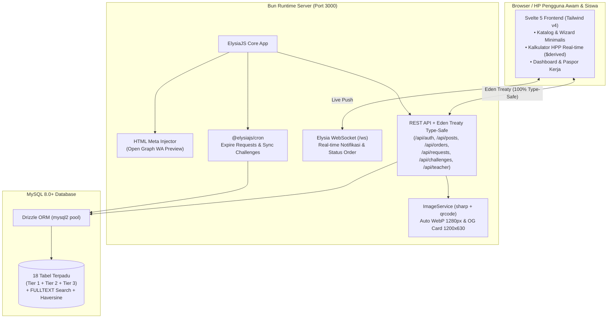
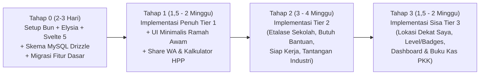

# Brainstorm & Blueprint Migrasi Tech Stack: Bun + ElysiaJS + Svelte + MySQL

> **Konteks:** Dokumen ini menganalisis seluruh rencana di folder `plan/` ([voc_market_analysis_brainstorm.md](voc_market_analysis_brainstorm.md), [tier1_implementation_plan.md](tier1_implementation_plan.md), [tier2_implementation_plan.md](tier2_implementation_plan.md), dan [tier3_implementation_plan.md](tier3_implementation_plan.md)) dan memetakannya ke arsitektur baru berbasis **Bun + ElysiaJS + Svelte + MySQL**.

---

## Daftar Isi
1. [Analisis Waktu & Keuntungan Migrasi Sekarang](#1-analisis-waktu--keuntungan-migrasi-sekarang)
2. [Bagaimana Stack Baru Memperkuat Misi VOC-Market (Tier 1–3)](#2-bagaimana-stack-baru-memperkuat-misi-voc-market-tier-13)
3. [4 Tantangan Kritis dari Plan Tier 1–3 & Solusinya di Stack Baru](#3-4-tantangan-kritis-dari-plan-tier-13--solusinya-di-stack-baru)
4. [Pilihan Arsitektur Proyek (Monorepo vs Hybrid)](#4-pilihan-arsitektur-proyek-monorepo-vs-hybrid)
5. [Pemetaan Komponen Laravel ke Bun + ElysiaJS + Svelte + MySQL](#5-pemetaan-komponen-laravel-ke-bun--elysiajs--svelte--mysql)
6. [Desain Skema MySQL 8.0+ Terpadu (Eksisting + Tier 1, 2, 3)](#6-desain-skema-mysql-80-terpadu-eksisting--tier-1-2-3)
7. [Fitur Baru yang "Terbuka" Berkat Bun + Elysia + Svelte](#7-fitur-baru-yang-terbuka-berkat-bun--elysia--svelte)
8. [Roadmap Migrasi + Implementasi Tier 1–3](#8-roadmap-migrasi--implementasi-tier-13)
9. [Keputusan Arsitektur yang Perlu Dikonfirmasi](#9-keputusan-arsitektur-yang-perlu-dikonfirmasi)

---

## 1. Analisis Waktu & Keuntungan Migrasi Sekarang

### Mengapa pindah SEKARANG adalah keputusan paling strategis?
1. **Kode eksisting masih sangat kecil (~10% dari total visi):**
   Saat ini codebase Laravel baru memiliki **2 Controller** ([`AuthController.php`](file:///m:/DATA/Project/voc-market/app/Http/Controllers/AuthController.php), [`PostController.php`](file:///m:/DATA/Project/voc-market/app/Http/Controllers/PostController.php)), **3 Model** (`User`, `Product`, `Category`), **1 Service** (`ImageService`), dan **12 file Blade**.
2. **85%+ fitur utama ada di Plan Tier 1, 2, dan 3 yang belum ditulis:**
   Jika kita pindah *sekarang* (sebelum menulis kode Tier 1), kita **tidak membuang pekerjaan dua kali**. Seluruh fitur Pesanan WA, Paspor Kerja, Verifikasi Guru, Etalase Sekolah, Papan Butuh Bantuan, Tantangan Industri, dan Kalkulator HPP langsung dibangun satu kali di atas stack baru.
3. **Lingkungan lokal sudah siap:**
   Di mesin pengembangan ini, **`bun 1.4.4` sudah terinstal di PATH** (bahkan `bun.lock` sudah ada di root), dan dump skema awal MySQL sudah tersedia di [`database/voc_market.sql`](file:///m:/DATA/Project/voc-market/database/voc_market.sql).

---

## 2. Bagaimana Stack Baru Memperkuat Misi VOC-Market (Tier 1–3)

Target utama VOC-Market adalah **siswa SMK** dan **masyarakat awam (orang tua, warga RT, UMKM)** yang sering menggunakan smartphone kelas *entry-level* dengan kuota internet terbatas.

| Komponen Stack | Dampak Langsung terhadap Misi & Fitur Tier 1–3 |
|---|---|
| **Svelte 5 (Runes)** | • **Ukuran bundle paling kecil & hemat kuota:** Svelte dikompilasi menjadi JS murni tanpa Virtual DOM berat, sangat cepat dibuka di HP murah.<br>• **UI Minimalis Tanpa Reload:** Wizard 3 langkah (Upload Karya & Posting "Butuh Bantuan" Tier 2 #6), filter katalog, dan perpindahan tab terasa instan seperti aplikasi native.<br>• **Reaktivitas `$state` & `$derived`:** Fitur **Kalkulator HPP (Tier 3 #10)** dan **Stepper Status Pesanan (Tier 1 #1)** menjadi sangat responsif tanpa manipulasi DOM manual.<br>• **Bebas DOM XSS:** Bug XSS `innerHTML` di [`search-modal.blade.php`](file:///m:/DATA/Project/voc-market/resources/views/components/search-modal.blade.php) otomatis hilang karena template `{item.name}` di Svelte selalu di-*escape* secara aman. |
| **ElysiaJS** | • **End-to-End Type Safety (Eden Treaty):** Perubahan struktur data di backend (misal status pesanan atau skor tantangan industri) otomatis terdeteksi di komponen Svelte saat diketik.<br>• **Validasi Skema Terpadu (`t.Object`):** Menggantikan `$request->validate()` Laravel dengan validasi super cepat sekaligus menghasilkan dokumentasi API OpenAPI/Swagger otomatis.<br>• **Native Cron & WebSocket:** Menjalankan job terjadwal Tier 2 (`requests:expire`, `challenges:sync-status`) dan notifikasi *real-time* langsung di dalam satu proses server. |
| **Bun Runtime** | • **`Bun.password` bawaan:** Mendukung `bcrypt` dan `argon2id` native C/Zig—bahkan kompatibel langsung dengan hash `$2y$` dari user Laravel lama!<br>• **`bun test` super cepat:** Menjalankan ratusan test Tier 1–3 dalam hitungan milidetik.<br>• **Startup & konsumsi RAM sangat rendah:** Mudah di-*deploy* di VPS murah untuk skala sekolah/komunitas. |
| **MySQL 8.0+ (via Drizzle ORM)** | • **Relasi & Transaksi Kuat (`InnoDB`):** Menjamin integritas `db.transaction()` saat pemosting memilih penawaran siswa (Tier 2 #6) dan saat mengurangi stok produk (Tier 1 #1).<br>• **Native `FULLTEXT` Index & Spatial/Math Function:** Pencarian produk/talenta jauh lebih kencang daripada `LIKE '%...%'`, dan rumus jarak **Haversine ("Dekat Saya" Tier 3 #12)** berjalan langsung di level SQL. |

---

## 3. 4 Tantangan Kritis dari Plan Tier 1–3 & Solusinya di Stack Baru

Saat memindahkan rencana Tier 1–3 dari **Laravel Blade (Server-Rendered)** ke **Svelte + ElysiaJS**, ada 4 hal teknis yang harus diantisipasi sejak awal agar tidak ada fitur yang rusak:

### ⚠️ Tantangan 1: Preview Link di WhatsApp (Tier 3 #14) & Paspor Kerja (Tier 1 #3)
- **Masalah:** Bot WhatsApp (saat membuat kotak *preview* foto + harga ketika link `/karya/12` dikirim di chat) **tidak menjalankan JavaScript**. Jika aplikasi dibangun sebagai *Single Page Application (SPA)* murni yang hanya mengembalikan `<div id="app"></div>`, maka WhatsApp hanya akan melihat halaman kosong!
- **Solusi Arsitektur (2 Opsi Pilihan):**
  - **Opsi A — Elysia HTML Meta Injector + Svelte 5 SPA (Paling Simpel, 1 Server Murni):**
    Frontend dikompilasi oleh Vite menjadi aset statis yang disajikan oleh ElysiaJS. Khusus untuk route publik (`/karya/:id`, `/paspor-kerja/:username`, `/sekolah/:slug`, `/sertifikat/:code`, `/tantangan/:slug`), sebelum Elysia mengirimkan `index.html`, Elysia mengambil baris data dari MySQL (1–2 ms) lalu menyuntikkan tag `<title>`, `<meta property="og:title">`, `<meta property="og:image">`, dan JSON-LD ke dalam `<head>`.
    *Keuntungan:* Tidak perlu kerumitan Node adapter SSR; **1 proses Bun menjalankan API + Frontend + WA Preview sekaligus!**
  - **Opsi B — SvelteKit (SSR) + ElysiaJS:**
    Menggunakan SvelteKit dengan `adapter-bun` untuk merender halaman di sisi server (`+page.server.ts`), sementara Elysia dipasang pada route `/api/[...slugs]/+server.ts` atau sebagai backend terpisah.
    *Keuntungan:* SEO penuh untuk seluruh isi halaman, cocok jika ingin halaman katalog terindeks penuh oleh Google tanpa JS.

### ⚠️ Tantangan 2: Konversi Gambar WebP & Pembuatan Kartu OG 1200×630
- **Di Laravel lama:** Menggunakan ekstensi PHP `gd` di [`app/Services/ImageService.php`](file:///m:/DATA/Project/voc-market/app/Services/ImageService.php).
- **Solusi di Bun + Elysia:**
  1. Gunakan **`sharp`** untuk memproses upload foto karya, avatar, dan bukti pesanan:
     ```ts
     // Menggantikan seluruh 160 baris ImageService.php hanya dengan:
     await sharp(await file.arrayBuffer())
       .rotate() // Auto-rotate EXIF dari kamera HP siswa
       .resize({ width: 1280, withoutEnlargement: true }) // Hemat kuota (Tier 1 Modul 0)
       .webp({ quality: 88 })
       .toFile(outputPath);
     ```
  2. Gunakan **SVG Template + `sharp`** untuk fitur **OgImageService (Tier 3 #14)**:
     Merender teks judul karya, harga `Rp ...`, nama siswa, dan nama SMK ke dalam template SVG, lalu menggabungkannya (*composite*) dengan foto karya menjadi gambar `.webp` 1200×630 piksel. Hasil teksnya jauh lebih tajam dan modern daripada `imagettftext` milik PHP GD!
  3. Gunakan package **`qrcode`** (output SVG string murni) untuk **QR Code Paspor Kerja (Tier 1 #3)** dan **Sertifikat Tantangan (Tier 2 #7)**.

### ⚠️ Tantangan 3: Halaman Cetak PDF Paspor Kerja (Tier 1 #3), Sertifikat (Tier 2 #7) & Laporan PKK (Tier 3 #13)
- **Solusi di Svelte:**
  - Buat komponen layout khusus cetak (`PrintLayout.svelte`) dengan aturan `@media print` Tailwind (`print:hidden` pada sidebar/bottom-nav, ukuran kertas `@page { size: A4; margin: 12mm; }`).
  - Tombol **"📄 Cetak / Simpan PDF"** memanggil `window.print()` langsung dari browser HP/laptop tanpa perlu menginstal headless Chrome (Puppeteer) yang memakan ratusan MB RAM di server.

### ⚠️ Tantangan 4: Penjadwalan Otomatis (Scheduled Jobs di Tier 2 & 3)
- **Di Plan Tier 2 & 3:** Kita membutuhkan job berkala untuk menutup permintaan kedaluwarsa (`requests:expire`), mengubah status tantangan saat lewat tenggat (`challenges:sync-status`), dan menghitung ulang statistik/level siswa (`stats:recalculate`).
- **Solusi di Bun + Elysia:**
  Gunakan plugin resmi **`@elysiajs/cron`**. Semua jadwal berjalan otomatis di dalam proses Bun yang sama tanpa perlu mengatur `crontab` Linux atau Task Scheduler Windows.

---

## 4. Pilihan Arsitektur Proyek (Monorepo vs Hybrid)

Berikut diagram arsitektur **Single-Repo Bun + ElysiaJS + Svelte 5 + Drizzle MySQL** yang paling bersih dan mudah dikelola:



### Struktur Folder yang Diusulkan
```text
voc-market/
├── src/
│   ├── server/                     # Backend ElysiaJS (Bun)
│   │   ├── index.ts                # Entry point server Elysia + Cron + Static/SSR
│   │   ├── db/
│   │   │   ├── index.ts            # Koneksi mysql2 pool + Drizzle instance
│   │   │   ├── schema/             # Definisi tabel MySQL (Drizzle Schema)
│   │   │   │   ├── users.ts        # users, sessions, schools, regions, subdistricts
│   │   │   │   ├── catalog.ts      # categories, products, product_daily_stats
│   │   │   │   ├── orders.ts       # orders, reviews (Tier 1)
│   │   │   │   ├── industry.ts     # job_requests, job_proposals, challenges, submissions, certificates, invitations (Tier 2)
│   │   │   │   └── gamification.ts # badges, user_badges, notifications, reports (Tier 2 & 3)
│   │   │   └── seed.ts             # Seeder demo lengkap (Tier 1, 2, 3)
│   │   ├── modules/                # Modular Elysia Controllers/Routes
│   │   │   ├── auth/               # Login, Register (SMK/Umum/Guru/Perusahaan), Session
│   │   │   ├── posts/              # Katalog, Detail, Upload, Edit/Hapus, Like, Share, HPP Suggestion
│   │   │   ├── orders/             # Checkout Tamu/User, Track Token, Update Status Siswa, Review
│   │   │   ├── teacher/            # Verifikasi Siswa, Stempel Karya TeFa, Rekap PKK
│   │   │   ├── passport/           # Data Paspor Kerja + QR Verification
│   │   │   ├── schools/            # Etalase Sekolah & Direktori (Tier 2)
│   │   │   ├── requests/           # Papan "Butuh Bantuan" & Penawaran Siswa (Tier 2)
│   │   │   ├── talent/             # Status "Siap Kerja", Filter Talenta & Undangan (Tier 2)
│   │   │   ├── challenges/         # Tantangan Industri, Penilaian & Sertifikat (Tier 2)
│   │   │   └── dashboard/          # Dashboard Penjual Mini, Buku Kas & Level/Badges (Tier 3)
│   │   ├── services/
│   │   │   ├── image.service.ts    # Konversi WebP (sharp) + Generator OG Card WA 1200x630
│   │   │   ├── pricing.service.ts  # Kalkulator HPP & Benchmark Harga Pasar
│   │   │   ├── geo.service.ts      # Rumus Haversine "Dekat Saya"
│   │   │   ├── stats.service.ts    # Kalkulasi talent_score, Level Kreator 1-4 & Lencana otomatis
│   │   │   └── og.service.ts       # Penyuntik meta Open Graph untuk crawler WhatsApp
│   │   └── middleware/
│   │       ├── auth.ts             # Guard session & role (smk, public, teacher, company, admin)
│   │       ├── rate-limit.ts       # Anti brute-force & spam per endpoint
│   │       └── security-headers.ts # X-Frame-Options, nosniff, Referrer-Policy
│   │
│   └── client/                     # Frontend Svelte 5 + Tailwind CSS v4
│       ├── App.svelte              # Router ringan & Layout Utama Minimalis
│       ├── lib/
│       │   ├── api.ts              # Eden Treaty client (terhubung ke tipe Elysia)
│       │   ├── stores/             # State reaktif Svelte 5 (auth.svelte.ts, toast.svelte.ts, location.svelte.ts)
│       │   └── components/
│       │       ├── layout/         # Navbar, BottomNav Berlabel (Mobile), Toast, LocationPill
│       │       ├── ui/             # CardKarya, BadgeStatus, StepperOrder, RatingStars, WizardStep
│       │       └── modals/         # ShareWaModal, QuickOrderModal, HppCalculatorAccordion
│       └── pages/                  # Halaman-halaman Aplikasi
│           ├── Home.svelte         # Katalog Grid + Search Bar Langsung + Filter Kategori & Lokasi
│           ├── PostDetail.svelte   # Detail Karya + Stempel Guru + Ulasan + Form Pesan 1-Klik
│           ├── PostForm.svelte     # Wizard 3 Langkah Upload/Edit + Kalkulator HPP Real-time
│           ├── OrderTrack.svelte   # Lacak Pesanan Pembeli (Tanpa Login) + Tombol WA + Form Ulasan
│           ├── SellerOrders.svelte # Pesanan Masuk & Update Progres Siswa
│           ├── SellerDashboard.svelte # Buku Kas, Omzet vs Laba HPP, Corong Konversi & Cetak PKK
│           ├── Passport.svelte     # Paspor Kerja / CV Digital Siap Cetak + QR Code
│           ├── TeacherPanel.svelte # Panel Verifikasi Guru Pembimbing & Stempel TeFa
│           ├── SchoolShow.svelte   # Etalase Sekolah & Unit Produksi TeFa
│           ├── RequestsBoard.svelte # Papan "Butuh Bantuan" & Form Penawaran Siswa
│           ├── TalentPool.svelte   # Pencarian Siswa "Siap Kerja" untuk Industri
│           └── Challenges.svelte   # Tantangan Industri & Halaman Sertifikat
├── drizzle.config.ts
├── package.json
├── tsconfig.json
└── vite.config.ts
```

---

## 5. Pemetaan Komponen Laravel ke Bun + ElysiaJS + Svelte + MySQL

Tabel ini memastikan **tidak ada satu pun fitur keamanan maupun fungsionalitas** dari project Laravel saat ini yang hilang saat migrasi:

| Fitur di Laravel Saat Ini | Implementasi Baru di Bun + ElysiaJS + Svelte + MySQL | Peningkatan |
|---|---|---|
| `AuthController` (Session Auth + Bcrypt) | Modul `auth` Elysia + tabel `sessions` MySQL + `Bun.password.hash/verify` (`bcrypt`) | Hash password di [`voc_market.sql`](file:///m:/DATA/Project/voc-market/database/voc_market.sql) tetap kompatibel 100% |
| `RateLimiter` (`login`, `register`, `uploads`, `likes`, `search`) | Middleware rate limiter Elysia berbasis IP + User ID dengan pesan Bahasa Indonesia yang sama | Lebih cepat (in-memory Map dengan auto-cleanup) |
| `SecurityHeaders.php` | Hook `onAfterHandle` di Elysia yang menyetel `X-Frame-Options`, `X-Content-Type-Options`, `Referrer-Policy`, `Permissions-Policy` | Identik 100% dan teruji di `bun test` |
| `ImageService::convertToWebp` (PHP GD) | `image.service.ts` dengan `sharp` (`rotate()`, `resize(1280)`, `webp({ quality: 88 })`) | 4–5x lebih cepat, otomatis membatasi lebar 1280px agar hemat kuota |
| Pencarian Live (`LIKE` dengan escape wildcard) | MySQL `FULLTEXT` index + fallback `LIKE` ter-escape di Drizzle ORM | Hasil pencarian lebih relevan dan cepat |
| Blade Components (`homepage`, `profile`, `add-product`, dll.) | Komponen **Svelte 5** dengan state reaktif (`$state`, `$derived`) + Tailwind CSS v4 | Tidak ada lagi duplikasi HTML, navigasi instan tanpa *white flash* reload |
| PHPUnit (`AuthTest`, `PostTest`, `SecurityTest`, `ImageUploadTest`) | `bun test` (`tests/auth.test.ts`, `tests/posts.test.ts`, `tests/tier1.test.ts`, dst.) | Eksekusi seluruh test suite < 1 detik |

---

## 6. Desain Skema MySQL 8.0+ Terpadu (Eksisting + Tier 1, 2, 3)

Karena kita langsung menggunakan **MySQL 8.0+** sejak awal, kita dapat mendesain skema yang bersih tanpa tambal-sulam migrasi seperti di SQLite lama:

### 6.1. Keunggulan Spesifik MySQL 8.0+ yang Akan Dipakai
1. **Tipe `ENUM` & `JSON` Native yang Tervalidasi:**
   - `users.user_type`: `ENUM('smk', 'public', 'teacher', 'company', 'admin')`
   - `products.type`: `ENUM('product', 'service', 'portfolio')`
   - `orders.status`: `ENUM('requested', 'accepted', 'in_progress', 'completed', 'cancelled')`
   - `products.cost_breakdown`: `JSON` (untuk rincian HPP Tier 3 #10)
   - `users.job_preferences`: `JSON` (untuk preferensi PKL/Magang/Kerja Tier 2 #8)
2. **`FULLTEXT` Index untuk Pencarian Cepat:**
   ```sql
   FULLTEXT KEY `ft_products_search` (`name`, `description`),
   FULLTEXT KEY `ft_users_search` (`name`, `username`, `school_name`, `major`, `skills`)
   ```
3. **Index Komposit untuk Filter Katalog, Talenta & Lokasi:**
   - `idx_products_catalog`: `(status, type, category_id, subdistrict_id, created_at)`
   - `idx_users_talent`: `(user_type, open_to_work, is_verified, talent_score DESC)`
   - `idx_orders_seller_status`: `(seller_id, status, completed_at)`

---

## 7. Fitur Baru yang "Terbuka" Berkat Bun + Elysia + Svelte

Dengan berpindah dari siklus *request-response* tradisional PHP ke **Bun + Elysia + Svelte**, beberapa pengalaman pengguna yang tadinya sulit/berat di Laravel menjadi sangat mudah diwujudkan:

1. **🔔 Notifikasi & Status Pesanan Real-Time (WebSocket Bawaan Bun):**
   - Saat pembeli menekan **"Pesan Sekarang"** (Tier 1) atau memilih penawaran siswa di **"Butuh Bantuan"** (Tier 2), dashboard siswa yang sedang terbuka langsung memunculkan kartu pesanan baru secara *live* disertai bunyi notifikasi lembut tanpa perlu me-refresh halaman.
2. **🧮 Kalkulator HPP & Simulasi Harga Instan (Svelte 5 `$derived`):**
   - Siswa dapat menggeser *slider* persentase margin keuntungan (misal dari 15% ke 30%) dan melihat harga jual serta estimasi laba bersihnya berubah secara *real-time* 60fps di layar HP.
3. **📷 Kompresi & Preview Kamera Langsung di HP Siswa:**
   - Sebelum mengunggah foto karya atau foto bukti penyelesaian pesanan (`proof_image` Tier 1), komponen Svelte dapat menampilkan preview ter-crop rapi dengan indikator ukuran file sehingga siswa dengan sinyal lemah tidak gagal upload.
4. **⚡ Mode Offline-Friendly / PWA Ringan:**
   - Karena frontend berupa bundle Svelte yang terpisah dari data API, halaman Katalog terakhir yang dibuka dan **Paspor Kerja Siswa** dapat di-cache oleh Service Worker. Siswa tetap bisa menunjukkan Paspor Kerjanya ke HRD meskipun sinyal di ruang wawancara sedang buruk!

---

## 8. Roadmap Migrasi + Implementasi Tier 1–3

Alih-alih menerjemahkan tampilan lama apa adanya lalu merombaknya lagi, kita **menggabungkan Migrasi Stack langsung dengan Desain Minimalis & Tier 1**:



### Rincian Tahap 0 + Tahap 1 (Target Eksekusi Pertama):
1. **Inisialisasi Stack Baru & MySQL:**
   - Setup proyek Bun + ElysiaJS + Drizzle ORM (terhubung ke MySQL `voc_market`) + Vite Svelte 5 + Tailwind CSS v4.
   - Buat skema Drizzle untuk tabel inti + seluruh tabel **Tier 1** (`users`, `sessions`, `categories`, `products`, `orders`, `reviews`) beserta kolom **HPP & OG Share** dari Tier 3.
   - Buat seeder MySQL yang memuat data demo realistis (siswa SMK, guru pembimbing, produk, jasa, portofolio, pesanan selesai, dan ulasan).
2. **Backend ElysiaJS (Parity + Tier 1):**
   - Modul Auth (Register Siswa/Umum/Guru, Login Email/Username, Logout, Session Middleware, Rate Limiter).
   - Modul Katalog & Karya (List dengan filter tipe/kategori/search, Detail `/api/posts/:id` dengan increment `views_count`, Create/Update/Delete Karya dengan konversi WebP `sharp`, Like toggle, Share counter, dan API saran harga HPP).
   - Modul Pesanan & Ulasan (`POST /api/orders` tanpa wajib login untuk pembeli awam, Lacak Pesanan via `review_token`, Update Status & Upload Bukti oleh siswa, Kirim Ulasan & Endorsement Tags).
   - Modul Guru Pembimbing & Paspor Kerja (Verifikasi siswa, stempel karya *TeFa Approved*, data CV Digital + SVG QR Code, serta injeksi Meta Tag Open Graph untuk WhatsApp).
3. **Frontend Svelte 5 (UI/UX Minimalis Ramah Orang Awam):**
   - Desain bersih 1 warna aksen utama, ukuran teks nyaman dibaca ($\ge 16\text{px}$), navigasi bawah HP dengan **ikon + teks label jelas**.
   - Halaman Beranda Katalog, Detail Karya + Form Pesan Cepat 1-Klik, Wizard Upload 3 Langkah + Kalkulator HPP, Halaman Lacak Pesanan Pembeli, Dashboard Pesanan Siswa, Panel Guru, dan Halaman Paspor Kerja siap cetak.
4. **Pengujian Otomatis (`bun test`):**
   - Memastikan seluruh skenario Auth, Upload WebP, Rate Limit, Security Headers, Alur Order, Ulasan, Verifikasi Guru, dan Paspor Kerja lulus 100%.

---

## 9. Keputusan Arsitektur yang Perlu Dikonfirmasi

Sebelum kita mengeksekusi migrasi dan pembangunan **Tahap 0 + Tier 1**, mohon konfirmasi 4 hal berikut:

| # | Pertanyaan Arsitektur | Rekomendasi Kami |
|---|---|---|
| 1 | **Struktur Folder:** Apakah kita menaruh stack baru (**Bun + Elysia + Svelte**) langsung menggantikan isi proyek ini (setelah memindahkan kode Laravel lama ke folder arsip `_legacy_laravel/` atau branch git terpisah)? | **Ya, simpan Laravel di branch git / folder arsip**, lalu gunakan root proyek untuk struktur monorepo bersih (`src/server` & `src/client`) agar langsung siap dijalankan dengan `bun run dev`. |
| 2 | **Mode Frontend Svelte:** Apakah menggunakan **Opsi A (Svelte 5 SPA + Elysia HTML Meta Injector untuk Preview WA)** atau **Opsi B (SvelteKit SSR penuh)**? | **Opsi A (Svelte 5 + Elysia Server Murni).** Jauh lebih ringan, seluruh routing API & injeksi Open Graph WhatsApp dikendalikan penuh oleh 1 server ElysiaJS tanpa komplikasi build dua server. |
| 3 | **Koneksi MySQL Lokal:** Apakah MySQL di Laragon Anda menggunakan konfigurasi standar (`host: 127.0.0.1`, `port: 3306`, `user: root`, `password: ""`, database: `voc_market`)? | Kita akan membacanya dari `.env` (`DATABASE_URL="mysql://root@127.0.0.1:3306/voc_market"`) dan menyiapkan script pembuat database otomatis jika belum ada. |
| 4 | **Cakupan Eksekusi Pertama:** Apakah kita mulai dengan membangun **Tahap 0 (Fondasi Bun + Elysia + Svelte + MySQL) sekaligus Fitur Tier 1**? | **Ya**, supaya begitu selesai Anda langsung bisa mencoba alur penuh dari Katalog → Pesan via WA → Siswa Terima & Selesaikan → Ulasan → Verifikasi Guru → Paspor Kerja di atas stack baru. |

