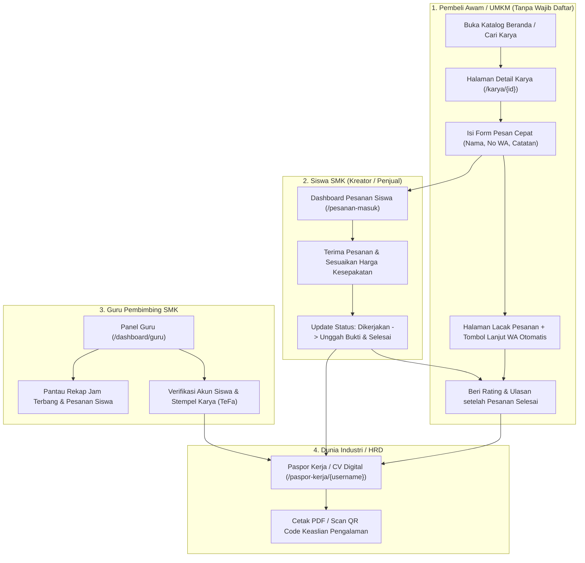

# Rencana Implementasi Detail — Tier 1 VOC-Market

> **Tujuan Tier 1:** Mengubah VOC-Market dari sekadar *feed pamer karya* menjadi **platform penghubung transaksi nyata & pencatat pengalaman kerja terverifikasi bagi siswa SMK**, dengan antarmuka **minimalis yang ramah bagi pengguna awam**.

---

## 1. Arsitektur & Alur Kerja Tier 1

---

## 2. Desain Skema Database (Migrations)

### 2.1. Tabel `orders` (Pencatatan Pesanan & Pengalaman Kerja)
**File:** `database/migrations/2026_10_29_010000_create_orders_table.php`

| Kolom | Tipe | Keterangan |
|---|---|---|
| `id` | `bigIncrements` | Primary key |
| `order_code` | `string(32)` unique | Kode ramah baca, misal `VOC-ORD-261029-A1B2` |
| `product_id` | `foreignId` (`products`) | Karya (barang/jasa) yang dipesan (`cascadeOnDelete`) |
| `seller_id` | `foreignId` (`users`) | Siswa SMK pemilik karya (`cascadeOnDelete`) |
| `buyer_id` | `foreignId` (`users`, nullable) | Terisi jika pembeli sedang login (`nullOnDelete`) |
| `buyer_name` | `string(120)` | Nama pembeli (wajib, memudahkan pembeli awam tanpa akun) |
| `buyer_phone` | `string(30)` | Nomor WhatsApp pembeli |
| `buyer_address` | `string(255)`, nullable | Alamat pengiriman / lokasi pengerjaan jasa |
| `buyer_notes` | `text`, nullable | Detail permintaan / spesifikasi pesanan |
| `quantity` | `unsignedInteger`, default `1` | Jumlah barang / paket jasa |
| `agreed_price` | `decimal(15,2)` | Harga total kesepakatan (default `price * quantity`, bisa diupdate siswa setelah nego di WA) |
| `status` | `string(20)`, default `'requested'` | `'requested'` (Diminta), `'accepted'` (Diterima), `'in_progress'` (Dikerjakan), `'completed'` (Selesai), `'cancelled'` (Dibatalkan) |
| `progress_note` | `text`, nullable | Catatan progres / serah terima dari siswa |
| `proof_image` | `string`, nullable | Foto bukti pengerjaan / hasil karya selesai (WebP) |
| `review_token` | `string(64)` unique | Token aman untuk akses halaman lacak & ulasan pembeli tanpa login |
| `accepted_at` | `timestamp`, nullable | Waktu pesanan diterima siswa |
| `completed_at` | `timestamp`, nullable | Waktu pesanan diselesaikan |
| `timestamps` | `created_at`, `updated_at` | Waktu pembuatan & pembaruan |

---

### 2.2. Tabel `reviews` (Ulasan & Endorsement Pelanggan Nyata)
**File:** `database/migrations/2026_10_29_010001_create_reviews_table.php`

| Kolom | Tipe | Keterangan |
|---|---|---|
| `id` | `bigIncrements` | Primary key |
| `order_id` | `foreignId` (`orders`) unique | 1 pesanan selesai maksimal 1 ulasan (`cascadeOnDelete`) |
| `product_id` | `foreignId` (`products`) | Karya yang diulas (`cascadeOnDelete`) |
| `seller_id` | `foreignId` (`users`) | Siswa SMK penerima ulasan (`cascadeOnDelete`) |
| `reviewer_name` | `string(120)` | Nama pemberi ulasan (diambil dari `buyer_name`) |
| `rating` | `unsignedTinyInteger` | Nilai bintang `1` sampai `5` |
| `comment` | `text` | Testimoni hasil kerja siswa |
| `endorsement_tags` | `string(255)`, nullable | Tag keahlian terbuktikan, dipisah koma (misal: `Rapi & Presisi,Tepat Waktu,Komunikasi Baik`) |
| `timestamps` | `created_at`, `updated_at` | Waktu ulasan dibuat |

---

### 2.3. Pembaruan Tabel `users` & `products` (Verifikasi Guru & Sekolah)
**File:** `database/migrations/2026_10_29_010002_add_verification_fields_to_users_and_products.php`

- **Tambahan pada tabel `users`:**
  - `user_type`: mendukung nilai `'smk'` (Siswa), `'public'` (Pembeli/UMKM), dan **`'teacher'`** (Guru Pembimbing SMK).
  - `nip` (`string(50)`, nullable): NIP / NUPTK / ID Guru Pembimbing.
  - `is_verified` (`boolean`, default `false`): Status siswa sudah diverifikasi oleh Guru Pembimbing sekolahnya.
  - `verified_by` (`foreignId` ke `users`, nullable): Guru yang memverifikasi.
  - `verified_at` (`timestamp`, nullable): Waktu verifikasi.
  - `is_ready_to_hire` (`boolean`, default `true`): Status siap menerima pesanan / siap direkrut industri.
- **Tambahan pada tabel `products`:**
  - `is_verified_by_teacher` (`boolean`, default `false`): Stempel karya telah ditinjau / lolos kurasi Guru Pembimbing (Teaching Factory / TeFa).
  - `verified_by` (`foreignId` ke `users`, nullable): Guru peninjau.
  - `teacher_note` (`string(255)`, nullable): Catatan rekomendasi dari guru pembimbing pada karya tersebut.

---

## 3. Rincian Modul, Routes, Controllers & Views

### Modul 0 — Perbaikan Bug Kritis, Keamanan & Optimasi (Fondasi)
1. **Perbaikan DOM XSS & Link Hasil Pencarian** di [`resources/views/components/search-modal.blade.php`](file:///m:/DATA/Project/voc-market/resources/views/components/search-modal.blade.php):
   - Menambahkan fungsi `escapeHtml(str)` sebelum merender nama user, sekolah, judul karya, dan harga.
   - Mengubah kartu hasil pencarian karya dari `
` statis menjadi `<a href="/karya/${p.id}">` sehingga langsung menuju halaman detail karya.
2. **Perbaikan Trigger Modal Pencarian Tanpa Dependensi Eksternal**:
   - Menambahkan handler JS ringan di [`search-modal.blade.php`](file:///m:/DATA/Project/voc-market/resources/views/components/search-modal.blade.php) untuk semua elemen `[data-modal-toggle="default-modal"]` dan `[data-modal-hide="default-modal"]` (serta tombol `Escape`), sehingga modal selalu berfungsi meskipun Flowbite JS tidak dimuat.
3. **Perbaikan State Tombol Like & Share Toast** di [`resources/views/components/homepage.blade.php`](file:///m:/DATA/Project/voc-market/resources/views/components/homepage.blade.php):
   - Saat `data.is_liked === false`, kembalikan ikon hati ke `fa-regular` dan hapus `fa-solid text-red-500`.
   - Menambahkan `id="post-{{ $post->id }}"` pada `<article>` dan mengarahkan link share ke route detail karya `route('post.show', $post->id)`.
   - Mengganti `alert()` kaku dengan komponen Toast Notification mengambang yang ramah pengguna.
4. **Optimasi Gambar Ramah Kuota** di [`app/Services/ImageService.php`](file:///m:/DATA/Project/voc-market/app/Services/ImageService.php):
   - Menetapkan default `$maxWidth = 1280` pada `convertToWebp()` agar foto dari kamera HP siswa otomatis terkompresi rapi tanpa mengorbankan ketajaman.
5. **Pembersihan Aset**:
   - Menghapus pemanggilan file lokal 404 (`voc-market/dist/font-awesome/...`) dan duplikasi script Font Awesome di [`resources/views/components/layouts/app.blade.php`](file:///m:/DATA/Project/voc-market/resources/views/components/layouts/app.blade.php) dan [`resources/views/components/main.blade.php`](file:///m:/DATA/Project/voc-market/resources/views/components/main.blade.php).

---

### Modul 1 — Halaman Detail Karya + Edit & Hapus Karya (Tier 1 #5)
- **Routes (`routes/web.php`):**
  - `GET /karya/{id}` → `[PostController::class, 'show']->name('post.show')`
  - `GET /karya/{id}/edit` → `[PostController::class, 'edit']->middleware('auth')->name('post.edit')`
  - `PUT /karya/{id}` → `[PostController::class, 'update']->middleware(['auth', 'throttle:uploads'])->name('post.update')`
  - `DELETE /karya/{id}` → `[PostController::class, 'destroy']->middleware('auth')->name('post.destroy')`
- **Controller ([`app/Http/Controllers/PostController.php`](file:///m:/DATA/Project/voc-market/app/Http/Controllers/PostController.php)):**
  - `show($id)`: Memuat `Product` beserta `user`, `category`, `verifier`, dan `reviews` (diurutkan terbaru). Menaikkan `views_count` sekali per sesi (`viewed_post_{$id}`).
  - `edit($id)`, `update(Request $request, $id)`, `destroy($id)`: Memastikan `Auth::id() === $post->user_id`, mendukung penggantian foto WebP atau mempertahankan foto lama.
- **Views:**
  - `resources/views/components/post-detail.blade.php`:
    - Foto besar yang jelas, label Bahasa Indonesia (`Barang`, `Jasa / Layanan`, `Portofolio Karya`), harga jelas, stok, dan jumlah dilihat.
    - **Kartu Kreator SMK**: Nama siswa, sekolah, jurusan, badge **"Terverifikasi Guru"** (jika sudah diverifikasi), rata-rata rating, dan jumlah pesanan selesai.
    - **Stempel Kurasi Guru (TeFa)** jika `is_verified_by_teacher` aktif, menampilkan nama guru & catatan rekomendasinya.
    - **Panel Pemesanan Cepat (Untuk Barang & Jasa)**: Tombol utama **"Pesan Sekarang"** yang membuka form ringkas (Nama Pembeli, No. WhatsApp, Jumlah, Catatan Kebutuhan) tanpa harus login.
    - **Tombol Edit & Hapus** khusus jika yang melihat adalah siswa pemilik karya.
    - **Daftar Ulasan Pelanggan Nyata** beserta tag keahlian yang diakui pelanggan.
  - `resources/views/components/edit-post.blade.php`: Form edit terpadu yang menyesuaikan field berdasarkan `type` (`product`, `service`, `portfolio`).

---

### Modul 2 — Alur Pesanan Sederhana & Pencatat Jam Terbang (Tier 1 #1)
- **Model Baru:** `app/Models/Order.php`
  - Relasi: `product()`, `seller()`, `buyer()`, `review()`.
  - Helper: `status_label` (Bahasa Indonesia: *Menunggu Konfirmasi*, *Diterima*, *Sedang Dikerjakan*, *Selesai*, *Dibatalkan*), `status_badge_color`, `whatsapp_url_for_buyer`, `whatsapp_url_for_seller`.
- **Controller Baru:** `app/Http/Controllers/OrderController.php`
  - `store(Request $request, $productId)`:
    - Validasi `buyer_name`, `buyer_phone`, `quantity`, `buyer_notes`, `buyer_address`.
    - Membuat `Order` dengan `order_code` unik & `review_token` acak 40 karakter.
    - Redirect ke halaman status pesanan (`route('orders.track', ['orderCode' => $order->order_code, 'token' => $order->review_token])`).
  - `track(Request $request, $orderCode)`:
    - Halaman pelacakan pesanan untuk pembeli (cukup menggunakan link + `token`, tidak perlu login).
    - Menampilkan tahapan visual (*stepper* 4 langkah yang mudah dipahami orang awam), tombol besar **"Hubungi Siswa via WhatsApp"** (dengan teks otomatis berisi Kode Pesanan), bukti pengerjaan dari siswa, dan **Form Beri Ulasan** ketika status sudah `completed`.
  - `indexSeller()`:
    - Halaman **"Pesanan Masuk & Riwayat Kerja"** khusus siswa SMK (`/pesanan`).
    - Menampilkan ringkasan (Pesanan Baru, Sedang Dikerjakan, Total Selesai, Total Pendapatan Tercatat) dan kartu tiap pesanan.
  - `updateStatus(Request $request, $id)`:
    - Hanya `seller_id === Auth::id()`.
    - Mengubah status (`accepted`, `in_progress`, `completed`, `cancelled`), memperbarui `agreed_price` (jika ada negosiasi harga jasa), `progress_note`, dan mengunggah `proof_image` (dikonversi ke WebP via `ImageService`).
    - Saat status berubah menjadi `completed`, jika tipe karya adalah `product` dan stok > 0, stok otomatis berkurang sesuai `quantity`.
- **Views Baru:**
  - `resources/views/components/order-track.blade.php` (Halaman Lacak Pesanan & Ulasan untuk Pembeli).
  - `resources/views/components/seller-orders.blade.php` (Dashboard Pesanan Masuk untuk Siswa SMK).

---

### Modul 3 — Ulasan & Rating Pelanggan Terverifikasi (Tier 1 #2)
- **Model Baru:** `app/Models/Review.php`
  - Relasi: `order()`, `product()`, `seller()`.
- **Endpoint di `OrderController@storeReview` (`POST /pesanan/{orderCode}/review`):**
  - Memastikan `order->status === 'completed'`, token valid (`hash_equals`), dan belum ada review sebelumnya.
  - Menyimpan rating bintang (1–5), komentar testimoni, dan pilihan cepat *endorsement tags* (`Rapi & Berkualitas`, `Tepat Waktu`, `Ramah & Sopan`, `Harga Sesuai`, `Solutif`).
- **Integrasi ke Model `User` & `Product`:**
  - Method/accessor di [`app/Models/User.php`](file:///m:/DATA/Project/voc-market/app/Models/User.php): `completedOrdersCount()`, `averageRating()`, `reviewsCount()`, `topEndorsedSkills()`.

---

### Modul 4 — Guru Pembimbing & Verifikasi Sekolah (Tier 1 #4)
- **Registrasi Guru Pembimbing** di [`resources/views/register.blade.php`](file:///m:/DATA/Project/voc-market/resources/views/register.blade.php) & [`app/Http/Controllers/AuthController.php`](file:///m:/DATA/Project/voc-market/app/Http/Controllers/AuthController.php):
  - Menambahkan pilihan peran ke-3 saat daftar: **Siswa SMK**, **Pembeli / Umum**, dan **Guru Pembimbing SMK** (mengisi Nama Sekolah, Jurusan/Bidang, dan NIP/NUPTK).
- **Controller Baru:** `app/Http/Controllers/TeacherController.php` (`middleware('auth')`)
  - `index()` (`GET /dashboard/guru`):
    - Menampilkan daftar siswa dan daftar karya dari sekolah yang sama (`school_name`), serta statistik pesanan selesai dari siswa-siswi sekolah tersebut.
  - `verifyStudent($userId)` (`POST /dashboard/guru/verify-student/{id}`):
    - Toggle status `is_verified` pada siswa SMK beserta `verified_by` & `verified_at`.
  - `verifyProduct(Request $request, $productId)` (`POST /dashboard/guru/verify-product/{id}`):
    - Memberikan stempel `is_verified_by_teacher = true` dan menyimpan `teacher_note` (misal: *"Karya telah diuji sesuai standar bengkel sekolah"*).
- **View Baru:**
  - `resources/views/components/teacher-dashboard.blade.php`

---

### Modul 5 — Paspor Kerja / CV Digital Siswa + QR Code (Tier 1 #3)
- **Controller Baru:** `app/Http/Controllers/PassportController.php`
  - `show($username)` (`GET /paspor-kerja/{username}` -> `name('passport.show')`):
    - Mengambil data siswa SMK, guru verifikator, statistik pesanan selesai, total pendapatan/nilai proyek, rata-rata rating, *endorsement tags* terbanyak, daftar riwayat pekerjaan nyata yang selesai (beserta ulasan pelanggan), dan karya portofolio terbaik.
- **View Baru:** `resources/views/passport.blade.php`
  - Tampilan dokumen profesional modern (bersih, mudah dibaca HRD industri, mendukung tombol **Cetak / Simpan PDF** via `window.print()` dengan stylesheet `@media print` khusus yang menyembunyikan tombol navigasi).
  - **QR Code Keaslian Digital**: Digenerate langsung di sisi server/SVG ringan menuju URL publik `/paspor-kerja/{username}` beserta kode verifikasi unik siswa.
  - Tombol **"Lihat Paspor Kerja / CV Digital"** dipasang mencolok di halaman Profil Siswa ([`resources/views/components/profile.blade.php`](file:///m:/DATA/Project/voc-market/resources/views/components/profile.blade.php)).

---

### Modul 6 — Redesign UI/UX Minimalis Ramah Pengguna Awam
1. **Navigasi & Bahasa yang Jelas ([`resources/views/components/sidebar.blade.php`](file:///m:/DATA/Project/voc-market/resources/views/components/sidebar.blade.php)):**
   - Mengubah gaya tombol warna-warni mencolok menjadi tampilan **bersih & seragam** (latar putih, teks abu tua, item aktif menggunakan warna utama `#2563EB` dengan kontras tinggi).
   - Pada tampilan HP (Bottom Bar), **selalu menampilkan teks label di bawah ikon**: `Beranda`, `Cari`, `Jual Karya`, `Pesanan`, `Profil` (atau `Panel Guru` bagi guru).
2. **Beranda Bergaya Etalase yang Mudah Dipahami ([`resources/views/components/homepage.blade.php`](file:///m:/DATA/Project/voc-market/resources/views/components/homepage.blade.php)):**
   - Menambahkan **Bar Pencarian Langsung & Filter Cepat** di bagian atas beranda (`Semua Karya`, `Barang Siap Beli`, `Jasa & Servis`, `Portofolio` + filter Kategori) sehingga orang awam tidak perlu mencari tombol modal untuk memfilter karya.
   - Memperjelas kartu karya: ukuran teks judul & harga diperbesar, menampilkan badge **"Terverifikasi Guru"** jika ada, menampilkan rating bintang & jumlah terjual/dipesan, serta tombol **"Lihat & Pesan"** yang jelas menuju halaman detail.
3. **Privasi Nomor Telepon Siswa:**
   - Menghapus eksposur nomor WA mentah di kartu beranda; mengarahkan interaksi melalui halaman detail karya / form pesanan agar setiap interaksi tercatat sebagai pengalaman siswa.

---

## 4. Rencana Pengujian Otomatis (Automated Verification)

Seluruh fitur baru dan perbaikan akan diuji menggunakan PHPUnit (`C:\laragon\bin\php\php-8.5.12-nts-Win32-vs17-x64\php.exe artisan test`):

1. **Test Suite Lama Tetap Lulus 100%:**
   - `AuthTest`, `PostTest`, `SecurityTest`, `ImageUploadTest`.
2. **Test Suite Baru (`tests/Feature/Tier1WorkflowTest.php`):**
   - **Detail, Edit & Hapus Karya:** Pengunjung dapat membuka `/karya/{id}` (`views_count` bertambah), pemilik karya dapat mengedit dan menghapus karyanya, pengguna lain ditolak (403).
   - **Alur Pesanan Tamu & Siswa:** Pembeli tanpa login dapat membuat pesanan di `/karya/{id}/order`, mendapatkan halaman lacak dengan `review_token`, dan siswa pemilik karya dapat mengubah status dari `requested` → `accepted` → `in_progress` → `completed` (stok produk berkurang otomatis).
   - **Ulasan Terverifikasi:** Pembeli hanya bisa mengirim ulasan setelah status pesanan `completed`, rating & *endorsement tags* tersimpan, dan tampil di detail karya serta profil siswa.
   - **Verifikasi Guru Pembimbing:** Akun `teacher` dapat memverifikasi siswa satu sekolah dan memberi stempel kurasi pada karya siswa.
   - **Paspor Kerja / CV Digital:** Halaman `/paspor-kerja/{username}` menampilkan metrik pesanan selesai, rata-rata rating, ulasan pelanggan, dan status verifikasi guru dengan HTTP 200.

