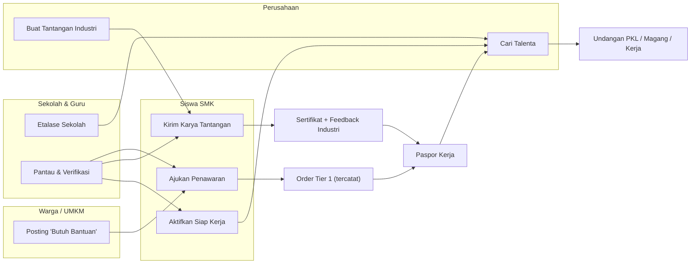
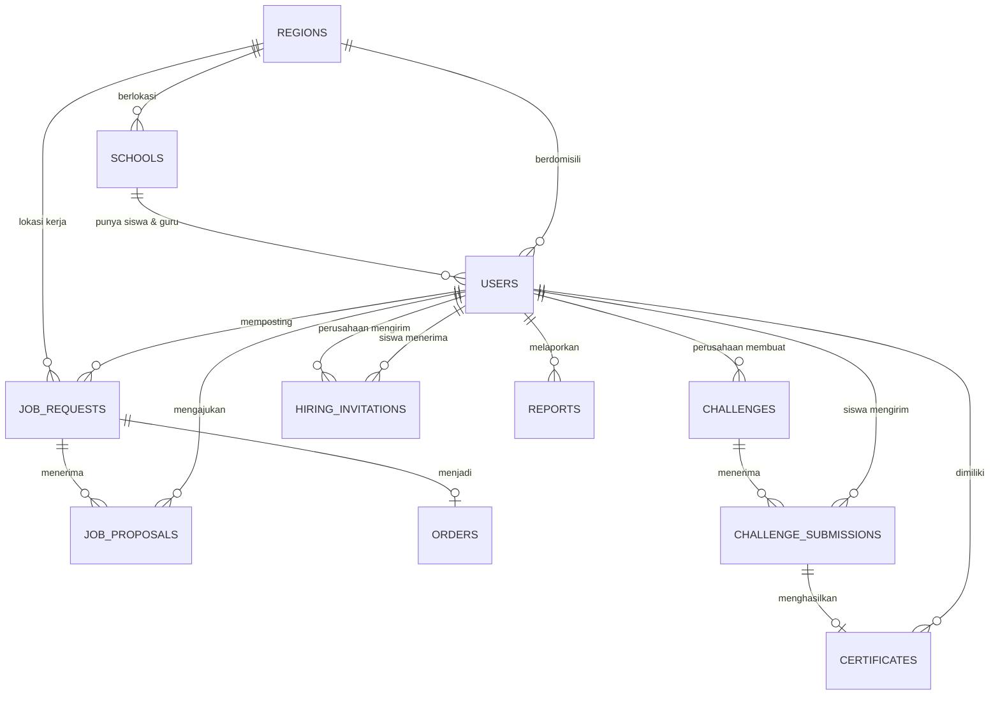
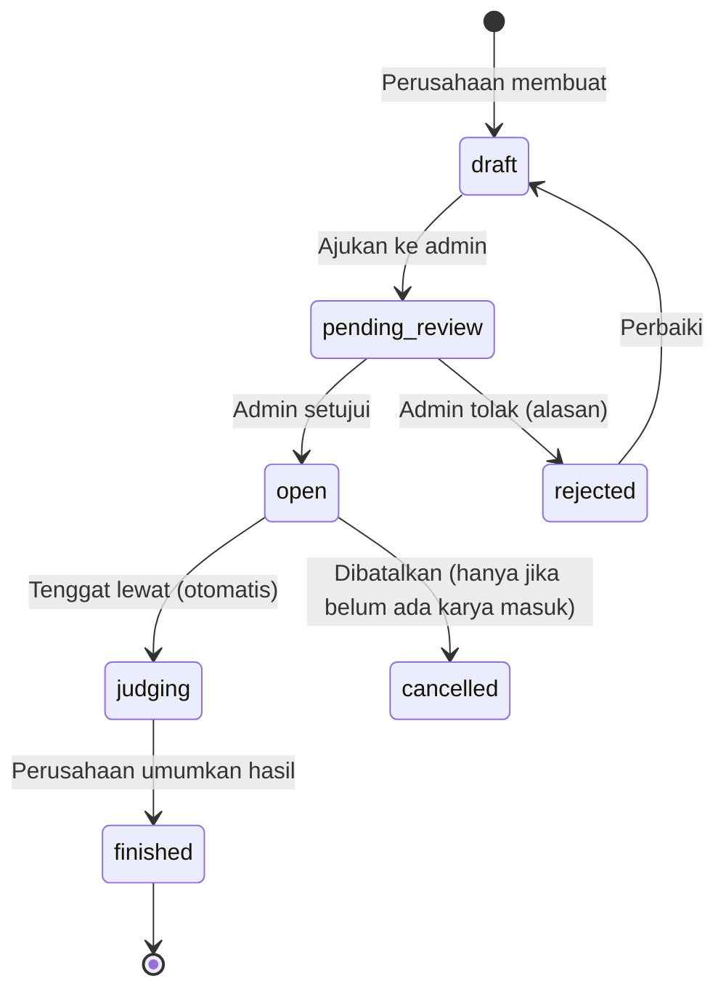

# Rencana Implementasi Detail — Tier 2 VOC-Market: Penghubung ke Industri

> **Tujuan Tier 2:** Membalik arah aliran peluang. Di Tier 1 siswa **menunggu** pembeli datang ke karyanya. Di Tier 2 **pasar dan industri yang datang ke siswa**: lewat permintaan warga/UMKM, tantangan dari perusahaan, rekrutmen talenta, dan etalase resmi sekolah.

> [!IMPORTANT]
> **Prasyarat:** Tier 2 dibangun di atas Tier 1 ([tier1_implementation_plan.md](tier1_implementation_plan.md)). Tier 2 butuh tabel `orders`, `reviews`, kolom verifikasi guru (`is_verified`, `user_type = 'teacher'`), dan halaman Paspor Kerja. Semua itu harus sudah selesai dan lulus test sebelum Tier 2 dimulai.

---

## Daftar Isi
1. [Gambaran Besar & Peran Pengguna](#1-gambaran-besar--peran-pengguna)
2. [Fase 2.0 — Fondasi Bersama](#2-fase-20--fondasi-bersama)
3. [Fase 2.1 — Etalase Sekolah (#9)](#3-fase-21--etalase-sekolah-9)
4. [Fase 2.2 — Papan "Butuh Bantuan" (#6)](#4-fase-22--papan-butuh-bantuan-6)
5. [Fase 2.3 — Status "Siap Kerja" & Cari Talenta (#8)](#5-fase-23--status-siap-kerja--cari-talenta-8)
6. [Fase 2.4 — Tantangan Industri (#7)](#6-fase-24--tantangan-industri-7)
7. [Integrasi ke Paspor Kerja](#7-integrasi-ke-paspor-kerja)
8. [UI/UX & Navigasi](#8-uiux--navigasi)
9. [Keamanan, Privasi & Perlindungan Siswa](#9-keamanan-privasi--perlindungan-siswa)
10. [Rencana Pengujian](#10-rencana-pengujian)
11. [Urutan Pengerjaan & Estimasi](#11-urutan-pengerjaan--estimasi)
12. [Keputusan yang Perlu Dikonfirmasi](#12-keputusan-yang-perlu-dikonfirmasi)

---

## 1. Gambaran Besar & Peran Pengguna

### 1.1. Peran setelah Tier 2

| Peran | `user_type` | Baru? | Bisa melakukan |
|---|---|---|---|
| Siswa SMK / Alumni | `smk` | – | Jual karya, **ajukan diri ke permintaan**, **ikut tantangan**, **aktifkan Siap Kerja**, terima undangan kerja |
| Warga / UMKM | `public` | – | Pesan karya, **posting permintaan "Butuh Bantuan"**, pilih siswa pelaksana |
| Guru Pembimbing | `teacher` | Tier 1 | Verifikasi siswa & karya, **memantau lamaran & undangan siswanya**, **mengelola Etalase Sekolah** (jika admin sekolah) |
| **Perusahaan / Industri** | **`company`** | **Baru** | **Buat Tantangan Industri**, **cari talenta**, **kirim undangan PKL/magang/kerja**, juga bisa posting permintaan |
| **Admin Platform** | flag `is_admin` | **Baru** | Verifikasi perusahaan & sekolah, moderasi tantangan, tindak lanjut laporan |

### 1.2. Alur besar



### 1.3. Diagram relasi data (ERD Tier 2)



---

## 2. Fase 2.0 — Fondasi Bersama

Fondasi ini dipakai oleh keempat fitur. Wajib dikerjakan lebih dulu.

### 2.1. Tabel `schools` — sekolah sebagai entitas resmi
Saat ini `users.school_name` hanya teks bebas, jadi "SMKN 1 Cibinong" dan "smkn 1 cibinong" tercatat sebagai dua sekolah berbeda. Etalase Sekolah dan filter talenta butuh data sekolah yang rapi.

**File:** `database/migrations/2026_11_01_000001_create_schools_table.php`

| Kolom | Tipe | Keterangan |
|---|---|---|
| `id` | `id()` | |
| `npsn` | `string(8)` unique, nullable | Nomor Pokok Sekolah Nasional, bisa dicek di referensi.data.kemdikbud.go.id |
| `name` | `string(150)` | Nama resmi, misal "SMK Negeri 1 Cibinong" |
| `slug` | `string(160)` unique | URL: `/sekolah/smkn-1-cibinong` |
| `region_id` | `foreignId` → `regions`, nullable | Kabupaten/kota |
| `address` | `string(255)`, nullable | |
| `logo` / `cover_image` | `string`, nullable | WebP via `ImageService` |
| `description` | `text`, nullable | Profil singkat sekolah |
| `majors` | `json`, nullable | Daftar jurusan, misal `["RPL","TKR","DKV"]` |
| `has_tefa` | `boolean`, default `false` | Punya unit Teaching Factory / unit produksi |
| `tefa_description` | `text`, nullable | Penjelasan unit produksi |
| `official_phone` | `string(30)`, nullable | Kontak resmi sekolah (bukan nomor siswa) |
| `website` | `string`, nullable | |
| `is_verified` | `boolean`, default `false` | Sudah diverifikasi admin (cek NPSN) |
| `timestamps` | | |

**Perubahan `users`:** tambah `school_id` (FK nullable, `nullOnDelete`) dan `is_school_admin` (boolean, khusus guru yang mengelola etalase).

**Migrasi data (backfill):** command `php artisan schools:backfill`:
1. Ambil semua `school_name` yang berbeda dari `users`.
2. Normalisasi: trim, huruf kecil, `SMK Negeri` → `SMKN`, rapikan spasi ganda.
3. Buat satu baris `schools` per nama hasil normalisasi, lalu isi `users.school_id`.
4. Kolom `school_name` dipertahankan sementara untuk kompatibilitas dan baru dihapus di rilis berikutnya.

**Dampak ke Tier 1:** pencocokan guru ↔ siswa di `TeacherController` diganti dari `school_name` ke `school_id`.

**Form registrasi:** input sekolah diganti menjadi *autocomplete* dari tabel `schools` (`GET /api/schools?q=`). Kalau sekolah belum ada, tersedia opsi "Sekolah saya belum terdaftar" untuk membuat sekolah baru berstatus `is_verified = false`.

### 2.2. Tabel `regions` — lokasi seragam
Dipakai untuk filter "dekat saya" di Papan Butuh Bantuan, filter lokasi talenta, dan lokasi sekolah.

**File:** `database/migrations/2026_11_01_000000_create_regions_table.php`

| Kolom | Tipe | Keterangan |
|---|---|---|
| `id` | `id()` | |
| `code` | `string(10)` unique | Kode wilayah Kemendagri, misal `32.01` |
| `name` | `string(100)` | "Kabupaten Bogor" |
| `province` | `string(100)` | "Jawa Barat" |
| `type` | `string(10)` | `kabupaten` / `kota` |

- **Seeder:** `RegionSeeder` membaca `database/data/regions.json` (sekitar 514 kabupaten/kota dari 38 provinsi; sumber data terbuka wilayah Indonesia). Cukup level kabupaten/kota, belum sampai kecamatan.
- **Perubahan `users`:** tambah `region_id` (FK nullable) untuk domisili.

### 2.3. Peran Perusahaan & Admin
**File:** `database/migrations/2026_11_01_000002_add_company_and_admin_fields_to_users.php`

| Kolom baru di `users` | Tipe | Keterangan |
|---|---|---|
| `is_admin` | `boolean`, default `false` | Admin platform (diset lewat seeder/tinker, tidak bisa lewat registrasi) |
| `company_name` | `string(150)`, nullable | Untuk `user_type = 'company'` |
| `company_sector` | `string(100)`, nullable | Manufaktur, Otomotif, IT, Kuliner, dll. |
| `company_website` | `string`, nullable | |
| `company_nib` | `string(20)`, nullable | Nomor Induk Berusaha (OSS) untuk verifikasi |
| `company_verified_at` | `timestamp`, nullable | Diisi admin. Belum terverifikasi = tidak bisa membuat tantangan atau mencari talenta |

- **Registrasi:** tambah pilihan peran ke-4, **"Perusahaan / Industri"**, di [register.blade.php](file:///m:/DATA/Project/voc-market/resources/views/register.blade.php) dan validasi di [AuthController.php](file:///m:/DATA/Project/voc-market/app/Http/Controllers/AuthController.php) (`Rule::in(['smk','public','teacher','company'])`).
- **Middleware baru:** `app/Http/Middleware/EnsureUserType.php`, alias `role`, dipakai seperti `->middleware('role:company')` atau `role:smk,teacher`.
- **Middleware baru:** `EnsureVerifiedCompany` (alias `company.verified`).
- **Policies baru** (menggantikan pengecekan `Auth::id() === ...` manual di controller): `JobRequestPolicy`, `JobProposalPolicy`, `ChallengePolicy`, `ChallengeSubmissionPolicy`, `HiringInvitationPolicy`, `SchoolPolicy`.

### 2.4. Notifikasi dalam aplikasi
Tier 2 punya banyak kejadian yang harus diketahui pengguna: penawaran baru masuk, penawaran dipilih, hasil tantangan diumumkan, undangan kerja datang. Ini butuh sistem notifikasi.

- `php artisan make:notifications-table` (tabel bawaan Laravel `notifications`, channel `database`).
- **Kelas notifikasi** (`app/Notifications/`):

| Notifikasi | Penerima | Pemicu |
|---|---|---|
| `NewProposalReceived` | Pemosting permintaan | Siswa mengajukan penawaran |
| `ProposalAccepted` / `ProposalRejected` | Siswa | Pemosting memilih atau menolak |
| `ChallengePublished` | Siswa dengan jurusan yang sesuai | Admin menyetujui tantangan |
| `ChallengeResultAnnounced` | Semua peserta | Perusahaan mengumumkan hasil |
| `SubmissionFeedbackGiven` | Siswa | Perusahaan memberi feedback |
| `HiringInvitationReceived` | Siswa **dan guru pembimbingnya** | Perusahaan mengirim undangan |
| `HiringInvitationAnswered` | Perusahaan | Siswa menerima atau menolak |
| `CompanyVerified` / `ChallengeApproved` | Perusahaan | Admin memverifikasi |

- **UI:** ikon lonceng dengan angka belum dibaca di navigasi, dan halaman `GET /notifikasi` (tandai dibaca: `POST /notifikasi/{id}/baca`, `POST /notifikasi/baca-semua`).
- **WhatsApp (tanpa API berbayar):** di halaman detail notifikasi tersedia tombol "Kabari via WhatsApp" berisi pesan `wa.me` yang sudah terisi, karena target pengguna lebih akrab dengan WhatsApp daripada lonceng notifikasi.

### 2.5. Laporan (Report) & Panel Admin
- **Tabel `reports`:** `id`, `reporter_id` (nullable), `reportable_type`, `reportable_id` (polymorphic: permintaan, tantangan, user, karya), `reason` (`penipuan`, `konten_tidak_pantas`, `eksploitasi`, `spam`, `lainnya`), `details`, `status` (`open`, `reviewed`, `actioned`, `dismissed`), `handled_by`, `timestamps`.
- Tombol **"Laporkan"** di detail permintaan, tantangan, dan profil.
- **`AdminController`** (`/admin`, middleware `auth` + `can:admin`):
  - `companies()`: verifikasi perusahaan (cek NIB/website) → isi `company_verified_at`.
  - `schools()`: verifikasi sekolah (cek NPSN), gabungkan sekolah duplikat (*merge*).
  - `challenges()`: setujui atau tolak tantangan (`pending_review` → `open`).
  - `reports()`: tindak lanjut laporan (sembunyikan konten / nonaktifkan akun).
- View: `resources/views/admin/*.blade.php` dengan tabel sederhana, tidak perlu panel admin pihak ketiga.

### 2.6. Statistik siswa tersimpan (denormalisasi)
Filter "rating minimal 4" dan "minimal 5 pesanan selesai" di pencarian talenta akan lambat kalau dihitung dari `orders`/`reviews` di setiap pencarian. Solusinya, simpan ringkasan statistik di `users`:

| Kolom baru di `users` | Diperbarui saat |
|---|---|
| `stat_completed_orders` (unsignedInteger) | Order berstatus `completed` |
| `stat_avg_rating` (decimal 3,2) | Review dibuat |
| `stat_reviews_count` (unsignedInteger) | Review dibuat |
| `stat_certificates_count` (unsignedInteger) | Sertifikat diterbitkan |
| `talent_score` (decimal 6,2) | Dihitung ulang tiap malam dan setelah kejadian di atas |
| `last_active_at` (timestamp) | Login / aksi penting |

- **Observer:** `OrderObserver`, `ReviewObserver`, dan `CertificateObserver` memanggil `App\Services\StudentStatsService::refresh($user)`.
- **Command:** `php artisan stats:recalculate` untuk memperbaiki data kalau tidak sinkron (dijadwalkan harian di [routes/console.php](file:///m:/DATA/Project/voc-market/routes/console.php)).

---

## 3. Fase 2.1 — Etalase Sekolah (#9)

> **Nilai:** Sekolah punya "toko resmi" di VOC-Market. Pembeli lebih percaya karena ada institusi di belakangnya, sekolah mendapat sarana promosi (PPDB, kerja sama industri), dan industri bisa melihat kualitas lulusan per sekolah.

### 3.1. Perubahan `products`
| Kolom | Tipe | Keterangan |
|---|---|---|
| `school_id` | FK nullable | Diisi otomatis dari `user.school_id` saat karya dibuat |
| `is_tefa` | `boolean`, default `false` | Karya dari unit produksi / Teaching Factory sekolah (ditandai guru) |
| `tefa_unit` | `string(100)`, nullable | Misal "Unit Produksi Roti SMKN 3 Malang" |

### 3.2. Routes
```php
Route::get('/sekolah', [SchoolController::class, 'index'])->name('schools.index');
Route::get('/sekolah/{school:slug}', [SchoolController::class, 'show'])->name('schools.show');
Route::middleware(['auth', 'role:teacher'])->group(function () {
    Route::get('/sekolah/{school:slug}/kelola', [SchoolController::class, 'edit'])->name('schools.edit');
    Route::put('/sekolah/{school:slug}', [SchoolController::class, 'update'])->name('schools.update');
    Route::post('/sekolah/{school:slug}/admin/{user}', [SchoolController::class, 'grantAdmin'])->name('schools.grant-admin');
});
Route::get('/api/schools', [SchoolController::class, 'search'])->middleware('throttle:search')->name('api.schools');
```

### 3.3. `SchoolController`
- `index()`: direktori sekolah dengan pencarian nama, filter provinsi/kabupaten, filter "punya TeFa", dan urutan "Paling aktif" (jumlah pesanan selesai 30 hari terakhir). Paginasi 24.
- `show(School $school)`: data halaman etalase (lihat 3.4). Query dibatasi per tab dan statistik di-cache 10 menit (`Cache::remember("school_stats_{$id}", 600, ...)`).
- `edit` / `update`: hanya guru dengan `school_id` yang sama **dan** `is_school_admin = true` (lewat `SchoolPolicy::update`). Bisa mengubah logo, cover, deskripsi, jurusan, info TeFa, dan kontak resmi.
- `grantAdmin`: admin sekolah bisa mengangkat guru lain di sekolahnya sebagai admin. Guru pertama yang mendaftar dari sebuah sekolah otomatis menjadi admin sekolah setelah sekolah diverifikasi platform.
- `search()`: JSON untuk *autocomplete* registrasi (id, name, region).

### 3.4. Tampilan `resources/views/schools/show.blade.php`
- **Header:** cover, logo, nama sekolah, badge "Terverifikasi" (jika NPSN valid), kabupaten/kota, chip jurusan, dan tombol "Hubungi Sekolah" (WhatsApp ke `official_phone`, bukan ke siswa).
- **Ringkasan angka (4 kartu besar):** Siswa Aktif · Karya Dipublikasikan · Pesanan Selesai · Rating Rata-rata.
- **Tab (satu tujuan per tab, sesuai prinsip minimalis):**
  1. **Karya**: grid karya siswa dengan filter jurusan dan tipe (Barang / Jasa / Portofolio).
  2. **Unit Produksi (TeFa)**: hanya muncul jika `has_tefa`. Menampilkan karya `is_tefa = true` beserta penjelasan unit.
  3. **Siswa Berprestasi**: 12 siswa dengan `talent_score` tertinggi. Kartu: foto, nama, jurusan, rating, badge Siap Kerja.
  4. **Prestasi**: sertifikat tantangan industri yang dimenangkan siswa sekolah ini (dari Fase 2.4).
- **SEO & berbagi:** meta Open Graph (judul, deskripsi, cover) supaya link etalase tampil menarik saat dibagikan sekolah ke grup WhatsApp orang tua.

### 3.5. Integrasi
- Nama sekolah di kartu karya, profil, dan Paspor Kerja menjadi link ke `/sekolah/{slug}`.
- Panel Guru (Tier 1) mendapat tombol **"Tandai sebagai Produk TeFa"** di setiap karya siswa.

---

## 4. Fase 2.2 — Papan "Butuh Bantuan" (#6)

> **Nilai:** Warga/UMKM yang tidak tahu harus mencari siapa cukup menulis kebutuhannya, lalu siswa yang mendatangi mereka. Setiap permintaan yang selesai otomatis menjadi **Order Tier 1** sehingga tercatat di Paspor Kerja.

### 4.1. Tabel `job_requests`
> Nama `job_requests` dipakai agar tidak bentrok dengan kelas `Illuminate\Http\Request`.

**File:** `database/migrations/2026_11_05_000000_create_job_requests_table.php`

| Kolom | Tipe | Keterangan |
|---|---|---|
| `id` | `id()` | |
| `code` | `string(24)` unique | `VOC-REQ-261105-X7K2` |
| `user_id` | FK → `users` | Pemosting (wajib login, lihat keputusan §12) |
| `category_id` | FK → `categories`, nullable | |
| `title` | `string(120)` | "Butuh logo untuk warung bakso" |
| `description` | `text` | Detail kebutuhan |
| `image` | `string`, nullable | Foto contoh/kondisi (misal foto motor yang rusak) |
| `budget_type` | `string(12)` | `fixed` (pasti), `range` (kisaran), `negotiable` (belum tahu, minta penawaran) |
| `budget_min` / `budget_max` | `decimal(15,2)`, nullable | |
| `work_mode` | `string(12)` | `onsite` (datang ke lokasi), `remote` (dari jarak jauh), `dropoff` (barang diantar/diambil) |
| `region_id` | FK → `regions`, nullable | Wajib jika `onsite`/`dropoff` |
| `location_detail` | `string(255)`, nullable | Kecamatan/patokan. **Alamat lengkap hanya terlihat oleh siswa terpilih** |
| `needed_by` | `date`, nullable | Tenggat |
| `max_proposals` | `unsignedTinyInteger`, default `10` | Batas penawaran supaya pemosting tidak kebanjiran |
| `status` | `string(16)`, default `open` | `open` → `assigned` → `completed`, atau `closed` / `expired` / `hidden` (moderasi) |
| `assigned_proposal_id` | FK nullable → `job_proposals` | |
| `proposals_count` / `views_count` | `unsignedInteger` | Counter |
| `expires_at` | `timestamp` | Default `created_at + 30 hari` atau `needed_by` |
| `timestamps`, `softDeletes` | | |

### 4.2. Tabel `job_proposals`
| Kolom | Tipe | Keterangan |
|---|---|---|
| `id` | `id()` | |
| `job_request_id` | FK, `cascadeOnDelete` | |
| `user_id` | FK → siswa | |
| `message` | `text` (maks. 1000) | "Saya bisa membuat 3 alternatif logo dalam 3 hari…" |
| `offered_price` | `decimal(15,2)` | |
| `estimated_days` | `unsignedSmallInteger` | |
| `portfolio_product_id` | FK nullable → `products` | Contoh karya pendukung |
| `status` | `string(12)`, default `pending` | `pending`, `accepted`, `rejected`, `withdrawn` |
| `timestamps` | | |
| **unique** | `(job_request_id, user_id)` | Satu siswa satu penawaran per permintaan |

### 4.3. Perubahan `orders` (Tier 1)
Supaya pekerjaan dari permintaan tercatat sebagai pengalaman yang sama dengan pesanan karya:

| Perubahan | Keterangan |
|---|---|
| `product_id` → **nullable** | Order dari permintaan tidak punya produk |
| `job_request_id` FK nullable (baru) | |
| `source` `string(12)` default `product` (baru) | `product` / `job_request` |

`Order::title` (accessor) mengambil `product->name` atau `jobRequest->title`.

### 4.4. Routes
```php
// Publik: siapa pun bisa melihat
Route::get('/butuh-bantuan', [JobRequestController::class, 'index'])->name('requests.index');
Route::get('/butuh-bantuan/{jobRequest:code}', [JobRequestController::class, 'show'])->name('requests.show');

Route::middleware('auth')->group(function () {
    // Pemosting (public / company / teacher)
    Route::get('/butuh-bantuan-baru', [JobRequestController::class, 'create'])->name('requests.create');
    Route::post('/butuh-bantuan', [JobRequestController::class, 'store'])->middleware('throttle:job-requests')->name('requests.store');
    Route::get('/permintaan-saya', [JobRequestController::class, 'mine'])->name('requests.mine');
    Route::post('/butuh-bantuan/{jobRequest:code}/tutup', [JobRequestController::class, 'close'])->name('requests.close');
    Route::post('/penawaran/{proposal}/pilih', [JobProposalController::class, 'accept'])->name('proposals.accept');
    Route::post('/penawaran/{proposal}/tolak', [JobProposalController::class, 'reject'])->name('proposals.reject');

    // Siswa
    Route::middleware('role:smk')->group(function () {
        Route::post('/butuh-bantuan/{jobRequest:code}/penawaran', [JobProposalController::class, 'store'])->middleware('throttle:proposals')->name('proposals.store');
        Route::post('/penawaran/{proposal}/tarik', [JobProposalController::class, 'withdraw'])->name('proposals.withdraw');
        Route::get('/penawaran-saya', [JobProposalController::class, 'mine'])->name('proposals.mine');
    });
});
```

### 4.5. Logika controller

**`JobRequestController`**
- `index(Request $r)`: daftar permintaan `status = open` dan belum kedaluwarsa.
  - Filter: kategori, kabupaten/kota, mode kerja, kisaran budget, "Bisa dari jarak jauh".
  - **Urutan "Cocok untukmu"** (jika yang login siswa): permintaan dengan kategori yang sesuai jurusan siswa dan kabupaten/kota yang sama tampil paling atas, lalu sisanya diurutkan dari yang terbaru. Pemetaan jurusan → kategori ada di `config/voc.php` (misal `TKR` → `Teknik Otomotif & Mesin`).
- `show()`: menaikkan `views_count` sekali per sesi.
  - Pengunjung umum: judul, deskripsi, budget, kabupaten/kota, tenggat, jumlah penawaran.
  - Pemosting: ditambah **daftar penawaran** (lihat 4.7).
  - Siswa: form "Ajukan Penawaran" atau status penawarannya sendiri.
  - Siswa terpilih: ditambah alamat lengkap dan tombol WhatsApp ke pemosting.
- `store()`: validasi, gambar via `ImageService::convertToWebp(..., 'requests')`, buat `code`, set `expires_at`.
- `close()`: pemosting menutup permintaan tanpa memilih siswa → `closed`, semua penawaran `pending` menjadi `rejected` dan siswa diberi notifikasi.

**`JobProposalController`**
- `store()`: tolak jika permintaan bukan `open`, sudah mencapai `max_proposals`, atau siswa adalah pemosting sendiri. Siswa yang **belum diverifikasi guru** tetap bisa mengajukan, tapi kartunya diberi label "Belum diverifikasi sekolah".
- `accept(JobProposal $p)` dijalankan dalam `DB::transaction`:
  1. `$p->status = accepted`; penawaran lain → `rejected`.
  2. `job_request.status = assigned`, `assigned_proposal_id = $p->id`.
  3. **Buat `Order`** (`source = job_request`, `seller_id` = siswa, `buyer_id` = pemosting, `agreed_price = offered_price`, `status = accepted`, `review_token` acak).
  4. Kirim notifikasi `ProposalAccepted` / `ProposalRejected`.
  5. Redirect ke halaman lacak order. Mulai dari sini alurnya **memakai ulang alur Order Tier 1** (Dikerjakan → Selesai → Ulasan).
- Saat Order selesai, `OrderObserver` mengubah `job_request.status` menjadi `completed`.

### 4.6. Scheduled job
- `php artisan requests:expire` (tiap jam): `open` dengan `expires_at < now()` → `expired`, lalu pemosting diberi notifikasi dengan tombol "Posting Ulang".

### 4.7. UI (ramah orang awam)
- **Form posting = wizard 3 langkah** (`resources/views/requests/create.blade.php`):
  1. **"Anda butuh bantuan apa?"**: pilih kategori dari ikon besar (🔧 Servis, 🎨 Desain, 🍰 Makanan, 💻 Komputer & Website, ⚡ Listrik, ✂️ Jahit, …), lalu isi judul. Di bawahnya ada contoh judul yang bisa diklik.
  2. **"Ceritakan detailnya"**: deskripsi, foto (opsional, bisa langsung dari kamera), mode kerja (3 tombol besar bergambar), lokasi, tenggat.
  3. **"Berapa anggarannya?"**: 3 pilihan: *Saya sudah tahu harganya* / *Kisaran* / *Belum tahu, minta penawaran*. Lalu ringkasan dan tombol **"Posting Sekarang"**.
- **Kartu permintaan** (daftar): judul besar, chip kategori, 📍 kabupaten/kota, 💰 budget, ⏰ "Butuh sebelum 12 Nov", 👥 "3 siswa menawarkan".
- **Membandingkan penawaran** (dilihat pemosting): satu kartu per siswa berisi foto, nama, sekolah, badge ✔ Terverifikasi Guru, ⭐ rating dan jumlah pesanan selesai, **harga** dan **lama pengerjaan** dicetak besar, pesan, dan contoh karya. Satu tombol utama **"Pilih Siswa Ini"** (dengan dialog konfirmasi).
- **Halaman siswa "Penawaran Saya"**: status dengan warna dan teks jelas (Menunggu / Terpilih 🎉 / Tidak terpilih).

### 4.8. Rate limiter baru (`AppServiceProvider`)
| Nama | Batas |
|---|---|
| `job-requests` | 5 posting / jam / user |
| `proposals` | 20 penawaran / jam / user |

---

## 5. Fase 2.3 — Status "Siap Kerja" & Cari Talenta (#8)

> **Nilai:** Siswa kelas akhir dan alumni bisa memberi tahu industri bahwa mereka siap PKL/magang/kerja. Perusahaan menyaring kandidat berdasarkan **bukti nyata** (pesanan selesai, rating, sertifikat tantangan), bukan sekadar nilai rapor.

### 5.1. Perubahan `users`
**File:** `database/migrations/2026_11_10_000000_add_open_to_work_fields_to_users.php`

| Kolom | Tipe | Keterangan |
|---|---|---|
| `student_status` | `string(12)`, nullable | `active` (kelas X–XI), `final_year` (kelas XII), `alumni` |
| `graduation_year` | `unsignedSmallInteger`, nullable | Tahun lulus / perkiraan lulus |
| `open_to_work` | `boolean`, default `false` | Badge **Siap Kerja** |
| `open_to_work_since` | `timestamp`, nullable | |
| `job_preferences` | `json`, nullable | `{"types":["pkl","magang","kerja","freelance"],"region_ids":[12,45],"willing_to_relocate":true}` |
| `headline` | `string(120)`, nullable | Satu kalimat, misal "Mekanik motor injeksi, siap kerja di bengkel resmi" |

> [!NOTE]
> Kolom `is_ready_to_hire` dari Tier 1 diganti namanya menjadi `accepting_orders` (artinya **"sedang menerima pesanan"**) supaya tidak tertukar dengan `open_to_work` (artinya **"mencari pekerjaan/PKL"**). Keduanya berbeda: siswa bisa menerima pesanan tanpa sedang mencari kerja.

**Syarat aktivasi badge** (dicek di `OpenToWorkController@update`):
- `user_type = smk` dan `student_status` adalah `final_year` atau `alumni`, **atau** jenis yang dipilih hanya `pkl` (PKL juga relevan untuk kelas XI).
- Profil minimal lengkap: foto, jurusan, sekolah, keahlian, headline, dan minimal 1 karya.
- Jika belum lengkap, tampilkan **checklist** yang menunjukkan bagian mana yang kurang. Cara ini lebih ramah daripada sekadar pesan error.

### 5.2. Tabel `hiring_invitations`
| Kolom | Tipe | Keterangan |
|---|---|---|
| `id` | `id()` | |
| `company_id` | FK → users (`company`) | |
| `student_id` | FK → users (`smk`) | |
| `type` | `string(12)` | `pkl`, `magang`, `kerja`, `freelance` |
| `position` | `string(120)` | "Junior Mekanik", "Staf Desain Grafis" |
| `message` | `text` | |
| `region_id` | FK nullable | Lokasi kerja |
| `salary_info` | `string(120)`, nullable | Opsional, misal "UMR + uang makan" |
| `status` | `string(12)`, default `pending` | `pending`, `accepted`, `declined`, `expired`, `withdrawn` |
| `responded_at` | `timestamp`, nullable | |
| `expires_at` | `timestamp` | Default 14 hari |
| `timestamps` | | |
| **index** | `(company_id, student_id, status)` | Mencegah undangan ganda yang masih `pending` |

### 5.3. Routes
```php
Route::middleware(['auth', 'role:smk'])->group(function () {
    Route::get('/siap-kerja', [OpenToWorkController::class, 'edit'])->name('open-to-work.edit');
    Route::put('/siap-kerja', [OpenToWorkController::class, 'update'])->name('open-to-work.update');
    Route::get('/undangan', [HiringInvitationController::class, 'inbox'])->name('invitations.inbox');
    Route::post('/undangan/{invitation}/terima', [HiringInvitationController::class, 'accept'])->name('invitations.accept');
    Route::post('/undangan/{invitation}/tolak', [HiringInvitationController::class, 'decline'])->name('invitations.decline');
});

Route::middleware(['auth', 'role:company', 'company.verified'])->group(function () {
    Route::get('/talenta', [TalentController::class, 'index'])->name('talent.index');
    Route::post('/talenta/{user:username}/simpan', [TalentController::class, 'toggleSave'])->name('talent.save');
    Route::get('/talenta-tersimpan', [TalentController::class, 'saved'])->name('talent.saved');
    Route::post('/talenta/{user:username}/undang', [HiringInvitationController::class, 'store'])->middleware('throttle:invitations')->name('invitations.store');
    Route::get('/undangan-terkirim', [HiringInvitationController::class, 'sent'])->name('invitations.sent');
});
```
Tambahan tabel kecil `saved_talents` (`company_id`, `student_id`, `note`, unique pair) untuk daftar kandidat yang disimpan perusahaan (*shortlist*).

### 5.4. `TalentController@index` — pencarian & filter

| Filter | Sumber data |
|---|---|
| Jurusan | `users.major` (dinormalisasi lewat daftar jurusan di `config/voc.php`) |
| Kabupaten/kota & provinsi | `users.region_id`, atau `job_preferences.region_ids` jika siswa bersedia pindah |
| Jenis peluang | `job_preferences.types` (JSON contains) |
| Rating minimal | `stat_avg_rating >=` |
| Pesanan selesai minimal | `stat_completed_orders >=` |
| Punya sertifikat tantangan | `stat_certificates_count > 0` |
| Terverifikasi guru saja | `is_verified = true` |
| Tahun lulus | `graduation_year` |
| Kata kunci keahlian | `skills LIKE` (pakai escape LIKE yang sudah ada di `PostController@search`) |

- Kueri dasar: `user_type = smk AND open_to_work = true AND status akun aktif`.
- **Urutan default: `talent_score` tertinggi**, dihitung oleh `StudentStatsService`:

$$
\text{talent\_score} = 35\cdot\frac{\text{avg\_rating}}{5} + 25\cdot\min\!\left(1, \frac{\log_{2}(1+\text{orders})}{5}\right) + 15\cdot\text{verified} + 15\cdot\min\!\left(1,\frac{\text{sertifikat}}{3}\right) + 10\cdot\text{aktif\_30\_hari}
$$

  Bobot disimpan di `config/voc.php` agar mudah disetel. Siswa baru tanpa pesanan tetap bisa muncul lewat sertifikat dan verifikasi guru.
- **Kartu kandidat:** foto, nama, headline, sekolah (link etalase), jurusan, ⭐ rating · ✅ X pesanan selesai · 🏆 Y sertifikat, chip jenis peluang, tombol **"Lihat Paspor Kerja"**, **"Simpan"**, dan **"Undang"**.
- **Nomor telepon dan email siswa TIDAK ditampilkan** di halaman talenta. Kontak baru terbuka setelah siswa menerima undangan.

### 5.5. `HiringInvitationController`
- `store()`: validasi, cegah undangan duplikat yang masih `pending`, kirim notifikasi ke siswa **dan** ke guru pembimbing di sekolah yang sama (pengawasan untuk siswa di bawah umur).
- `accept()`: status `accepted` → perusahaan mendapat nomor WhatsApp siswa (ditampilkan di `/undangan-terkirim`) dan siswa mendapat kontak perusahaan.
- `decline()`: bisa memilih alasan singkat (opsional) agar perusahaan mendapat masukan.
- Scheduled: `invitations:expire` (harian).

### 5.6. Rate limiter
| Nama | Batas |
|---|---|
| `invitations` | 30 undangan / hari / perusahaan |

---

## 6. Fase 2.4 — Tantangan Industri (#7)

> **Nilai:** Siswa mengerjakan *brief* nyata dengan standar industri dan **setiap peserta mendapat feedback** dari praktisi. Pemenang mendapat hadiah, sertifikat terverifikasi, dan peluang magang. Bagi perusahaan, ini cara murah untuk menemukan talenta.

### 6.1. Tabel `challenges`
**File:** `database/migrations/2026_11_15_000000_create_challenges_table.php`

| Kolom | Tipe | Keterangan |
|---|---|---|
| `id` | `id()` | |
| `company_id` | FK → users (`company`) | |
| `slug` | `string` unique | `/tantangan/desain-kemasan-kopi-nusantara` |
| `title` | `string(150)` | |
| `summary` | `string(255)` | Ringkasan satu kalimat untuk kartu |
| `brief` | `longText` | Latar belakang, masalah, target |
| `requirements` | `text` | Syarat peserta & teknis |
| `deliverables` | `text` | Apa yang harus dikumpulkan |
| `judging_criteria` | `json` | `[{"name":"Kreativitas","weight":40},{"name":"Kesesuaian brief","weight":30},…]` |
| `category_id` | FK nullable | |
| `target_majors` | `json`, nullable | `["DKV","RPL"]` untuk notifikasi & rekomendasi |
| `cover_image` / `brief_attachment` | `string`, nullable | Attachment PDF maks. 10 MB, disimpan di disk `public/challenges` |
| `reward_types` | `json` | Subset dari `["uang","sertifikat","magang","kerja","produk"]` |
| `prize_description` | `text` | "Juara 1: Rp1.500.000 + magang 3 bulan" (**wajib diisi**) |
| `winner_slots` | `unsignedTinyInteger`, default `3` | |
| `submission_deadline` | `datetime` | |
| `announcement_date` | `date` | Maksimal 30 hari setelah tenggat |
| `ip_policy` | `string(20)` | `winner_only` (hanya karya pemenang dialihkan haknya) / `none` (semua hak tetap milik siswa) |
| `status` | `string(16)`, default `draft` | `draft` → `pending_review` → `open` → `judging` → `finished`, atau `rejected` / `cancelled` |
| `rejection_reason` | `string`, nullable | Diisi admin |
| `submissions_count` / `views_count` | `unsignedInteger` | |
| `timestamps`, `softDeletes` | | |

### 6.2. Tabel `challenge_submissions`
| Kolom | Tipe | Keterangan |
|---|---|---|
| `id` | `id()` | |
| `challenge_id` | FK, `cascadeOnDelete` | |
| `user_id` | FK → siswa | |
| `title` | `string(150)` | |
| `description` | `text` | Penjelasan solusi & proses |
| `images` | `json` | 1–5 gambar WebP |
| `attachment` | `string`, nullable | PDF/ZIP maks. 20 MB |
| `external_link` | `string`, nullable | Figma, GitHub, YouTube |
| `status` | `string(16)`, default `submitted` | `submitted`, `shortlisted`, `winner`, `runner_up`, `honorable`, `participant`, `disqualified` |
| `rank` | `unsignedTinyInteger`, nullable | |
| `scores` | `json`, nullable | Skor per kriteria dari perusahaan |
| `feedback` | `text`, nullable | **Wajib diisi perusahaan untuk semua finalis**, disarankan untuk semua peserta |
| `submitted_at` | `timestamp` | Revisi diperbolehkan sampai tenggat |
| `timestamps` | | |
| **unique** | `(challenge_id, user_id)` | |

> Tantangan tim (beberapa siswa sekaligus) belum masuk Tier 2 dan dicatat sebagai pengembangan berikutnya.

### 6.3. Tabel `certificates`
| Kolom | Tipe | Keterangan |
|---|---|---|
| `id` | `id()` | |
| `code` | `string(20)` unique | `VOC-CERT-7F3K9Q2M`, dicetak beserta QR |
| `user_id` | FK | |
| `challenge_id` | FK nullable | Disiapkan agar sertifikat bisa berasal dari sumber lain di masa depan |
| `submission_id` | FK nullable | |
| `type` | `string(16)` | `winner`, `runner_up`, `finalist`, `participant` |
| `title` | `string(200)` | "Juara 1 — Tantangan Desain Kemasan Kopi Nusantara" |
| `issuer_name` | `string(150)` | Nama perusahaan |
| `issued_at` | `date` | |
| `revoked_at` | `timestamp`, nullable | Jika terbukti curang |

### 6.4. Routes
```php
// Publik
Route::get('/tantangan', [ChallengeController::class, 'index'])->name('challenges.index');
Route::get('/tantangan/{challenge:slug}', [ChallengeController::class, 'show'])->name('challenges.show');
Route::get('/sertifikat/{certificate:code}', [CertificateController::class, 'show'])->name('certificates.show');

// Perusahaan terverifikasi
Route::middleware(['auth', 'role:company', 'company.verified'])->prefix('kelola-tantangan')->name('company.challenges.')->group(function () {
    Route::get('/', [CompanyChallengeController::class, 'index'])->name('index');
    Route::get('/baru', [CompanyChallengeController::class, 'create'])->name('create');
    Route::post('/', [CompanyChallengeController::class, 'store'])->name('store');
    Route::get('/{challenge:slug}/edit', [CompanyChallengeController::class, 'edit'])->name('edit');
    Route::put('/{challenge:slug}', [CompanyChallengeController::class, 'update'])->name('update');
    Route::post('/{challenge:slug}/ajukan', [CompanyChallengeController::class, 'submitForReview'])->name('submit');
    Route::get('/{challenge:slug}/karya', [CompanyChallengeController::class, 'submissions'])->name('submissions');
    Route::put('/karya/{submission}/nilai', [CompanyChallengeController::class, 'grade'])->name('grade');
    Route::post('/{challenge:slug}/umumkan', [CompanyChallengeController::class, 'announce'])->name('announce');
});

// Siswa
Route::middleware(['auth', 'role:smk'])->group(function () {
    Route::get('/tantangan/{challenge:slug}/kirim', [ChallengeSubmissionController::class, 'create'])->name('submissions.create');
    Route::post('/tantangan/{challenge:slug}/kirim', [ChallengeSubmissionController::class, 'store'])->middleware('throttle:uploads')->name('submissions.store');
    Route::put('/karya-tantangan/{submission}', [ChallengeSubmissionController::class, 'update'])->name('submissions.update');
    Route::get('/tantangan-saya', [ChallengeSubmissionController::class, 'mine'])->name('submissions.mine');
});
```

### 6.5. Siklus hidup tantangan



- **Scheduled `challenges:sync-status`** (tiap 15 menit): `open` dengan `submission_deadline < now()` → `judging`, lalu perusahaan diberi notifikasi untuk mulai menilai.
- **Pengingat:** jika `announcement_date` sudah lewat dan status masih `judging`, perusahaan diingatkan, admin diberi tahu, dan badge "Pengumuman terlambat" tampil di halaman publik untuk menjaga akuntabilitas.

### 6.6. Logika kunci
- **`CompanyChallengeController@store`**: wizard 4 langkah: ① Info dasar & cover → ② Brief, syarat, hasil yang dikumpulkan (dengan contoh template) → ③ Kriteria penilaian (total bobot harus 100) & hadiah → ④ Jadwal & kebijakan hak cipta → simpan sebagai `draft`.
- **`grade()`**: perusahaan mengisi skor per kriteria (otomatis dihitung rata-rata tertimbang), status (`shortlisted`/`winner`/…), dan feedback. Disediakan *template* feedback supaya cepat diisi: "Yang sudah bagus…", "Yang bisa ditingkatkan…".
- **`announce()`** dalam `DB::transaction`:
  1. Validasi: jumlah `winner`/`runner_up` ≤ `winner_slots`, dan semua finalis sudah punya feedback.
  2. Peserta yang belum diberi status → `participant`.
  3. **Terbitkan `certificates`** untuk pemenang, runner-up, finalis, dan peserta (sertifikat partisipasi hanya jika karyanya tidak didiskualifikasi).
  4. `status = finished`, kirim `ChallengeResultAnnounced` ke semua peserta.
  5. Pemenang dengan `reward_types` berisi `magang`/`kerja` otomatis mendapat draf `hiring_invitations` yang tinggal dikonfirmasi perusahaan.
- **`ChallengeSubmissionController@store`**: hanya ketika `open` dan sebelum tenggat. Gambar via `ImageService`. Siswa boleh merevisi sampai tenggat.
- **Kerahasiaan karya:** sebelum `finished`, karya peserta **hanya bisa dilihat perusahaan penyelenggara dan pemiliknya**, untuk mencegah saling contek. Setelah `finished`, karya pemenang tampil publik di halaman tantangan, dan karya peserta lain tampil hanya jika siswa mengizinkannya (`is_public` boolean, default `true`).

### 6.7. Sertifikat & verifikasi
- `CertificateController@show`: halaman publik `/sertifikat/{code}`, desain siap cetak (`@media print`, ukuran A4 landscape). Isinya nama siswa, sekolah, judul tantangan, peringkat, perusahaan penerbit, tanggal, dan **QR code** ke URL itu sendiri.
- QR memakai generator SVG yang sama dengan Paspor Kerja Tier 1 (satu service `App\Services\QrCodeService`).
- Jika `revoked_at` terisi, halaman menampilkan banner merah "Sertifikat ini telah dicabut".

### 6.8. Tampilan
- **`/tantangan` (daftar)**: kartu besar dengan cover, logo perusahaan, judul, chip hadiah (💰 Uang · 🎓 Magang · 📜 Sertifikat), ⏰ hitung mundur "Sisa 12 hari", dan 👥 jumlah peserta. Tab: **Sedang Berlangsung** · **Penjurian** · **Selesai**. Untuk siswa ada filter "Sesuai jurusanku".
- **`/tantangan/{slug}`**: hero (judul, perusahaan terverifikasi ✔, hadiah, hitung mundur) lalu brief, syarat, hasil yang dikumpulkan, kriteria penilaian, jadwal (timeline visual), dan kebijakan hak cipta dalam bahasa sederhana. Tombol sticky **"Ikut Tantangan"**. Setelah selesai, tampil galeri pemenang beserta feedback juri.
- **"Tantangan Saya"** (siswa): status tiap karya, feedback yang diterima, dan unduh sertifikat.

---

## 7. Integrasi ke Paspor Kerja

Halaman `/paspor-kerja/{username}` (Tier 1) diperluas:

| Bagian baru | Sumber |
|---|---|
| Badge **Siap Kerja** + headline + jenis peluang dicari | `open_to_work`, `headline`, `job_preferences` |
| **Pekerjaan dari Permintaan Warga** (terpisah dari pesanan karya) | `orders` dengan `source = job_request` + review |
| **Prestasi Tantangan Industri** + link verifikasi sertifikat | `certificates` (tidak dicabut) |
| **Feedback Industri** (kutipan feedback juri pada karya finalis) | `challenge_submissions.feedback` (hanya jika siswa mengizinkan) |
| Link ke **Etalase Sekolah** | `school.slug` |

---

## 8. UI/UX & Navigasi

Mengikuti prinsip minimalis Tier 1 (Modul 6): satu warna aksen, teks dasar minimal 16px, satu tombol utama per layar, label selalu terlihat, bahasa sehari-hari.

### 8.1. Navigasi bawah (mobile) per peran

| Peran | Item 1 | Item 2 | Item 3 (tengah) | Item 4 | Item 5 |
|---|---|---|---|---|---|
| Siswa | Beranda | **Peluang** | Jual Karya (+) | Pesanan | Profil |
| Warga/UMKM | Beranda | **Butuh Bantuan** | Posting (+) | Pesanan Saya | Profil |
| Perusahaan | Beranda | **Talenta** | Buat Tantangan (+) | Undangan | Profil |
| Guru | Beranda | Siswa | Panel Guru | **Sekolah** | Profil |

Pencarian pindah ke bar pencarian di atas beranda (sudah direncanakan di Tier 1), sehingga slot "Cari" di navigasi bisa dipakai untuk fitur Tier 2.

### 8.2. Halaman hub "Peluang" untuk siswa (`/peluang`)
Satu pintu masuk agar siswa tidak bingung mencari fitur:
- **Tab 1 — Butuh Bantuan**: permintaan "Cocok untukmu" di bagian atas.
- **Tab 2 — Tantangan**: tantangan yang sesuai jurusan.
- **Tab 3 — Undangan Kerja**: kotak masuk undangan (dengan angka belum dibaca).
- **Banner** jika belum aktif Siap Kerja: "Kamu kelas XII? Aktifkan **Siap Kerja** agar perusahaan bisa menemukanmu" dengan tombol **Aktifkan**.

### 8.3. Komponen Blade yang dapat dipakai ulang (`resources/views/components/ui/`)
`card-request`, `card-challenge`, `card-talent`, `card-school`, `badge-status`, `stepper`, `countdown`, `empty-state`, `wizard-step`, `rating-stars`, `toast`. Gunanya menjaga tampilan konsisten dan mengurangi duplikasi kelas Tailwind yang panjang seperti di view sekarang.

### 8.4. Teks ramah awam (contoh)
| Hindari | Gunakan |
|---|---|
| "Submit proposal" | "Ajukan Penawaran" |
| "Assigned" | "Siswa sudah dipilih" |
| "Judging" | "Sedang dinilai" |
| "Open to work" | "Siap Kerja" |
| "Talent pool" | "Cari Siswa Berbakat" |

---

## 9. Keamanan, Privasi & Perlindungan Siswa

> [!WARNING]
> Sebagian besar siswa SMK berusia di bawah 18 tahun. Tier 2 membuka interaksi langsung dengan orang dewasa asing (pemosting & perusahaan), jadi perlindungan berikut **wajib**, bukan opsional.

1. **Kontak bertahap:** nomor WhatsApp siswa tidak pernah tampil publik. Nomor baru terbuka setelah (a) penawarannya dipilih, atau (b) siswa menerima undangan. Begitu juga alamat lengkap pemosting, yang hanya terlihat oleh siswa terpilih.
2. **Pengawasan guru:** guru pembimbing melihat semua penawaran, order dari permintaan, dan undangan kerja siswa di sekolahnya (tab baru di Panel Guru). Undangan kerja selalu ikut dinotifikasikan ke guru.
3. **Perusahaan harus terverifikasi** (NIB/website dicek admin) sebelum bisa membuat tantangan atau melihat talenta.
4. **Anti-eksploitasi tantangan:** hadiah wajib diisi, kebijakan hak cipta wajib dipilih dan ditampilkan jelas, karya non-pemenang tetap milik siswa, perusahaan wajib memberi feedback ke finalis, dan semua tantangan dimoderasi admin sebelum tayang.
5. **Tombol Laporkan** di semua konten Tier 2, ditangani admin.
6. **Escape output:** semua data pengguna dirender lewat `{{ }}`. Untuk render via JS dipakai helper `escapeHtml` (perbaikan XSS di Tier 1) dan tidak ada `{!! !!}` untuk input pengguna.
7. **Upload:** validasi `mimes` + ukuran, gambar dikonversi ulang ke WebP (sekaligus membuang payload tersembunyi), dan PDF/ZIP disimpan dengan nama acak tanpa eksekusi (`.htaccess` di folder upload sudah ada).
8. **Otorisasi lewat Policy** untuk semua aksi ubah/hapus/pilih/nilai, ditambah test untuk akses ilegal (403).
9. **UU PDP:** halaman Kebijakan Privasi diperbarui (data apa yang dilihat perusahaan) dan siswa bisa mematikan Siap Kerja kapan saja (data langsung hilang dari pencarian talenta).

---

## 10. Rencana Pengujian

Dijalankan dengan:
```powershell
C:\laragon\bin\php\php-8.5.12-nts-Win32-vs17-x64\php.exe artisan test
```

**Test lama (Tier 0 & Tier 1) harus tetap lulus 100%.** Test baru dikelompokkan di `tests/Feature/Tier2/`:

| File | Skenario utama |
|---|---|
| `SchoolTest.php` | Backfill `schools:backfill` menggabungkan nama yang sama; halaman `/sekolah/{slug}` 200 dan menampilkan karya; hanya admin sekolah yang bisa mengedit (guru lain 403); filter TeFa |
| `JobRequestTest.php` | Warga memposting permintaan (wizard valid / tidak valid); siswa melihat urutan "Cocok untukmu"; batas `max_proposals`; siswa tidak bisa menawar permintaannya sendiri; alamat lengkap tersembunyi dari non-terpilih |
| `JobProposalTest.php` | Satu siswa satu penawaran; **memilih penawaran membuat `Order` (`source = job_request`)** dan menolak penawaran lain; order selesai → permintaan `completed`; review masuk ke statistik siswa |
| `OpenToWorkTest.php` | Checklist profil menolak aktivasi jika belum lengkap; siswa kelas X tidak bisa memilih `kerja`; menonaktifkan badge langsung menghilangkan siswa dari `/talenta` |
| `TalentSearchTest.php` | Perusahaan belum terverifikasi 403; filter jurusan, region, rating, pesanan selesai; urutan `talent_score`; nomor telepon tidak muncul di HTML |
| `HiringInvitationTest.php` | Undangan duplikat pending ditolak; guru menerima notifikasi; kontak terbuka setelah undangan diterima; command expire |
| `ChallengeTest.php` | Siklus status (draft → review → open → judging → finished); bobot kriteria harus 100; siswa tidak bisa mengirim setelah tenggat; karya peserta tersembunyi sebelum selesai; `announce` menolak jika finalis belum diberi feedback |
| `CertificateTest.php` | Sertifikat terbit sesuai peringkat; `/sertifikat/{code}` 200; sertifikat dicabut menampilkan banner; muncul di Paspor Kerja |
| `NotificationTest.php` | Setiap kejadian di §2.4 mengirim notifikasi ke penerima yang benar (`Notification::fake()`) |
| `Tier2SecurityTest.php` | Policy 403 untuk aksi ilegal; rate limiter `job-requests`, `proposals`, `invitations`; XSS payload di judul permintaan ter-escape |

**Factory baru:** `SchoolFactory`, `RegionFactory`, `JobRequestFactory`, `JobProposalFactory`, `ChallengeFactory`, `ChallengeSubmissionFactory`, `CertificateFactory`, `HiringInvitationFactory`, ditambah state di `UserFactory` (`->smk()`, `->teacher()`, `->company(verified: true)`, `->openToWork()`).

**Seeder demo:** `Tier2DemoSeeder` berisi 3 sekolah (dengan TeFa), 2 perusahaan terverifikasi, 6 permintaan berbagai status, 2 tantangan (1 berjalan, 1 selesai dengan pemenang & sertifikat), dan 3 siswa Siap Kerja. Gunanya untuk demo ke sekolah atau calon mitra.

---

## 11. Urutan Pengerjaan & Estimasi

| Fase | Isi | Estimasi | Alasan urutan |
|---|---|---|---|
| **2.0 Fondasi** | `regions`, `schools` + backfill, peran `company` & `is_admin`, middleware & policies, notifikasi, `reports`, panel admin, statistik siswa | 1–1,5 minggu | Dibutuhkan oleh semua fitur |
| **2.1 Etalase Sekolah** | Direktori + halaman sekolah, kelola etalase, TeFa | 0,5–1 minggu | Paling sederhana, langsung memberi nilai promosi bagi sekolah mitra (membantu adopsi) |
| **2.2 Butuh Bantuan** | Permintaan, penawaran, integrasi ke Order Tier 1, expire job | 1,5 minggu | Menambah transaksi nyata, sehingga statistik dan Paspor Kerja jadi berisi |
| **2.3 Siap Kerja** | Badge, checklist, cari talenta, simpan, undangan | 1 minggu | Butuh statistik dari 2.2 supaya filter bermakna |
| **2.4 Tantangan Industri** | Tantangan, karya, penilaian, sertifikat, moderasi | 1,5–2 minggu | Paling kompleks; butuh perusahaan terverifikasi dan sertifikat memperkaya talent score |
| **Integrasi & QA** | Paspor Kerja, hub Peluang, navigasi per peran, seeder demo, regresi | 0,5 minggu | |
| **Total** | | **± 6–7,5 minggu** (1 developer) | |

---

## 12. Keputusan yang Perlu Dikonfirmasi

| # | Pertanyaan | Rekomendasi |
|---|---|---|
| 1 | Apakah memposting "Butuh Bantuan" **wajib login**? (Berbeda dengan pemesanan karya di Tier 1 yang boleh tanpa akun) | **Wajib login** dengan registrasi `public` yang singkat (nama, WA, password). Pemosting berinteraksi dengan siswa di bawah umur, jadi perlu akuntabilitas. Pemesanan karya tetap boleh tanpa akun |
| 2 | Siapa yang menjadi **admin platform** pertama dan siapa yang memverifikasi perusahaan/sekolah? | Tim pengelola VOC-Market (flag `is_admin` lewat seeder). Nanti bisa didelegasikan ke dinas pendidikan / mitra |
| 3 | Apakah tantangan boleh **tanpa hadiah uang** (hanya sertifikat/magang)? | Boleh, tapi minimal satu hadiah nyata (sertifikat + feedback wajib, ditambah salah satu dari uang/magang/produk) |
| 4 | Apakah siswa **kelas X–XI** boleh mengaktifkan Siap Kerja untuk **PKL**? | Ya, khusus jenis `pkl`. Jenis `kerja` hanya untuk kelas XII/alumni |
| 5 | Apakah **alumni** tetap terhubung ke etalase sekolahnya? | Ya, ditampilkan di tab "Alumni Berprestasi" dan menambah kredibilitas sekolah |
| 6 | Perlu **komisi/biaya** untuk perusahaan (posting tantangan atau akses talenta)? | Belum di Tier 2. Gratis dulu untuk membangun basis pengguna; model bisnis dibahas setelah ada traksi |

