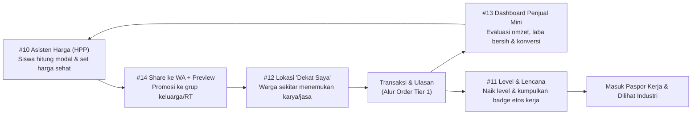
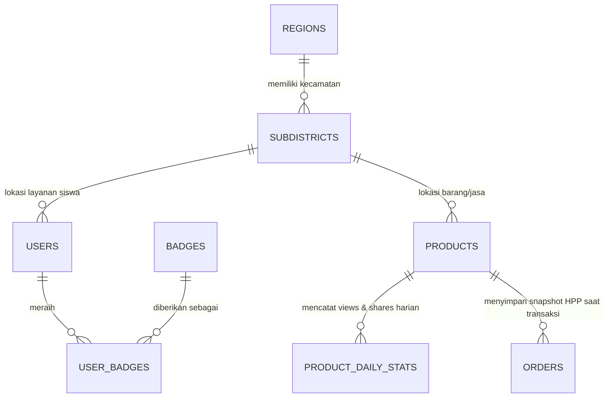

# Rencana Implementasi Detail — Tier 3 VOC-Market: Pembelajaran & Retensi

> **Tujuan Tier 3:** Menjadikan VOC-Market bukan hanya tempat transaksi sesaat, melainkan **laboratorium kewirausahaan nyata (PKK — Produk Kreatif dan Kewirausahaan)** yang membuat siswa terus berkembang, membantu siswa mempromosikan karyanya secara mandiri, dan mempermudah warga sekitar menemukan layanan vokasi terdekat.

> [!IMPORTANT]
> **Prasyarat & Keterkaitan:**
> - **Dari Tier 1 ([tier1_implementation_plan.md](tier1_implementation_plan.md)):** Memanfaatkan tabel `orders`, `reviews`, `views_count` pada halaman detail karya (`/karya/{id}`), verifikasi guru, dan Paspor Kerja (`/paspor-kerja/{username}`).
> - **Dari Tier 2 ([tier2_implementation_plan.md](tier2_implementation_plan.md)):** Memanfaatkan tabel `regions` (Kabupaten/Kota), `schools`, `StudentStatsService` (`stat_completed_orders`, `stat_avg_rating`), dan sistem `notifications`.

---

## Daftar Isi
1. [Gambaran Besar & Sinergi Antar-Fitur Tier 3](#1-gambaran-besar--sinergi-antar-fitur-tier-3)
2. [Fase 3.1 — Bagikan ke WhatsApp dengan Preview & Kit Promosi (#14)](#2-fase-31--bagikan-ke-whatsapp-dengan-preview--kit-promosi-14)
3. [Fase 3.2 — Asisten Harga (Kalkulator HPP & Saran Harga Pasar) (#10)](#3-fase-32--asisten-harga-kalkulator-hpp--saran-harga-pasar-10)
4. [Fase 3.3 — Lokasi Kecamatan & Fitur "Dekat Saya" (#12)](#4-fase-33--lokasi-kecamatan--fitur-dekat-saya-12)
5. [Fase 3.4 — Sistem Level, Lencana (Badges) & Progres Siswa (#11)](#5-fase-34--sistem-level-lencana-badges--progres-siswa-11)
6. [Fase 3.5 — Dashboard Penjual Mini & Buku Kas Siswa (#13)](#6-fase-35--dashboard-penjual-mini--buku-kas-siswa-13)
7. [Integrasi ke Paspor Kerja & Panel Guru](#7-integrasi-ke-paspor-kerja--panel-guru)
8. [Prinsip UI/UX Minimalis pada Fitur Tier 3](#8-prinsip-uiux-minimalis-pada-fitur-tier-3)
9. [Keamanan, Privasi Lokasi & Perlindungan Siswa](#9-keamanan-privasi-lokasi--perlindungan-siswa)
10. [Rencana Pengujian Otomatis (PHPUnit)](#10-rencana-pengujian-otomatis-phpunit)
11. [Urutan Pengerjaan & Estimasi Waktu](#11-urutan-pengerjaan--estimasi-waktu)
12. [Keputusan yang Perlu Dikonfirmasi](#12-keputusan-yang-perlu-dikonfirmasi)

---

## 1. Gambaran Besar & Sinergi Antar-Fitur Tier 3

Kelima fitur di Tier 3 dirancang sebagai **satu siklus pertumbuhan (Growth & Learning Loop)** bagi siswa SMK:



### Diagram Relasi Data Tambahan (ERD Tier 3)



---

## 2. Fase 3.1 — Bagikan ke WhatsApp dengan Preview & Kit Promosi (#14)

> **Mengapa dikerjakan pertama di Tier 3?** Pembeli pertama siswa SMK biasanya berasal dari **lingkaran terdekat** (grup WhatsApp keluarga, warga RT/RW, guru, dan alumni). Saat ini, membagikan link karya ke WhatsApp hanya menampilkan URL polos tanpa foto dan harga.

### 2.1. Perubahan Database
**File:** `database/migrations/2026_12_01_000000_add_share_and_og_fields_to_products.php`

| Tabel | Kolom Baru | Tipe | Keterangan |
|---|---|---|---|
| `products` | `shares_count` | `unsignedInteger`, default `0` | Jumlah klik tombol bagikan |
| `products` | `og_image` | `string`, nullable | Path kartu gambar Open Graph 1200×630 (`storage/og/post-{id}.webp`) |

### 2.2. Meta Tag Open Graph Dinamis di Layout Utama
**File yang diperbarui:** [`resources/views/components/layouts/app.blade.php`](file:///m:/DATA/Project/voc-market/resources/views/components/layouts/app.blade.php)

Mendukung properti meta dinamis di `<head>` (dengan nilai *fallback* default jika tidak diisi):
- `og:title`, `og:description`, `og:url`, `og:type` (`product` / `profile` / `website`), `og:site_name` (`VOC-Market SMK`).
- `og:image`, `og:image:width` (`1200`), `og:image:height` (`630`).
- `twitter:card` (`summary_large_image`).
- **JSON-LD Schema.org (`Product` / `Service`)** pada halaman `/karya/{id}` agar mesin pencari & WhatsApp mengenali harga (`Rp ...`), ketersediaan stok, dan rating bintang karya siswa.

### 2.3. Generator Gambar Kartu Preview Otomatis (`OgImageService`)
**File Baru:** `app/Services/OgImageService.php`

Menggunakan ekstensi **PHP GD** (yang sudah terbukti berjalan di [`app/Services/ImageService.php`](file:///m:/DATA/Project/voc-market/app/Services/ImageService.php)) untuk membuat gambar komposit berukuran **1200×630 piksel** saat karya dibuat atau diperbarui:
- Sisi kiri (630×630): Foto karya siswa yang di-*crop* rapi (`object-cover`).
- Sisi kanan (570×630, latar putih bersih):
  - Badge tipe karya (`BARANG` / `JASA` / `PORTOFOLIO`).
  - Judul karya (maks. 2 baris).
  - **Kotak Harga Mencolok** (misal `Rp 55.000`).
  - Nama siswa + Nama SMK + Badge `"✔ Terverifikasi Guru"` (jika ada).
  - Footer: `"Pesan langsung di VOC-Market"`.

> **Hasil di WhatsApp:** Saat link `/karya/12` ditempel ke chat WhatsApp, penerima langsung melihat foto produk, harga, dan nama sekolah di dalam *preview card* sebelum mengklik link.

### 2.4. Modal "Kit Promosi WhatsApp" (1-Klik Sebar)
**Endpoint Baru:** `POST /karya/{id}/share` (`PostController@recordShare`, middleware `throttle:likes`) → menaikkan `shares_count`.

Saat siswa atau pengunjung menekan tombol **Bagikan**, muncul *bottom sheet* / modal minimalis berisi:
1. **Pilihan Template Pesan Siap Kirim** (otomatis mengisi nama karya, harga, sekolah, dan link):
   - *Gaya Santun (Untuk Grup Keluarga / Warga RT):*
     > *"Assalamualaikum / Halo Bapak & Ibu, perkenalkan saya [Nama] siswa jurusan [Jurusan] dari [Nama SMK]. Saat ini saya menerima pesanan [Nama Karya] dengan harga [Harga]. Hasil karya dan pemesanan bisa dilihat langsung di sini: [Link]. Terima kasih atas dukungannya 🙏"*
   - *Gaya Singkat (Untuk Status WA / Grup Teman):*
     > *"Butuh [Nama Karya]? Buatan langsung siswa [Nama SMK], harga terjangkau mulai [Harga]! Cek detail & pesan di: [Link]"*
2. **Tombol "Kirim ke WhatsApp Sekarang"** (`https://wa.me/?text=...`) dan **"Salin Teks & Link"**.

---

## 3. Fase 3.2 — Asisten Harga (Kalkulator HPP & Saran Harga Pasar) (#10)

> **Nilai Edukasi:** Banyak siswa SMK menjual karya terlalu murah (lupa menghitung listrik, kemasan, atau tenaganya sendiri) atau terlalu mahal karena tidak tahu harga pasar. Fitur ini mengintegrasikan kurikulum **PKK (Produk Kreatif dan Kewirausahaan)** langsung ke dalam alur upload karya.

### 3.1. Perubahan Database
**File:** `database/migrations/2026_12_03_000000_add_hpp_fields_to_products_and_orders.php`

| Tabel | Kolom Baru | Tipe | Keterangan |
|---|---|---|---|
| `products` | `cost_breakdown` | `json`, nullable | Rincian HPP: `{"material":25000,"packaging":3000,"overhead":2000,"labor":10000}` |
| `products` | `estimated_hours` | `decimal(5,1)`, nullable | Estimasi jam pengerjaan per unit/pesanan |
| `orders` | `unit_cost_snapshot` | `decimal(15,2)`, default `0` | Menyimpan `cost_price * quantity` saat pesanan dibuat agar perhitungan laba bersih historis tetap akurat walau harga modal berubah nanti |

### 3.2. Service `PricingAssistantService` & API Saran Harga
**File Baru:** `app/Services/PricingAssistantService.php`
**Route Baru:** `GET /api/pricing-suggestion?category_id={id}&type={product|service}` (middleware `auth`, `throttle:search`)

Method utama:
1. `getMarketBenchmark(int $categoryId, string $type): array`
   - Mengambil distribusi harga dari karya `published` pada kategori & tipe yang sama (minimal 3 sampel; jika kurang dari 3, gunakan nilai acuan dasar per kategori di `config/voc.php`):
   - Mengembalikan: `count`, `min_price`, `median_price`, `p25_price` (batas bawah wajar), `p75_price` (batas atas wajar), dan `avg_margin_percent`.
2. `analyzeMargin(float $costPrice, float $sellingPrice, float $estimatedHours = 0): array`
   - Rumus perhitungan:

$$
\text{Laba Kotor per Unit} = \text{price} - \text{cost\_price}
$$

$$
\text{Margin (\%)} = \left(\frac{\text{price} - \text{cost\_price}}{\text{price}}\right) \times 100\% \quad \text{dan} \quad \text{Markup (\%)} = \left(\frac{\text{price} - \text{cost\_price}}{\text{cost\_price}}\right) \times 100\%
$$

   - Menghasilkan status indikator:
     - 🔴 `loss` (`price < cost_price`): *"Harga jual di bawah modal! Kamu akan rugi Rp X setiap penjualan."*
     - 🟠 `thin` (`margin < 15%`): *"Untung terlalu tipis (Rp X). Pastikan biaya kemasan & tenagamu sudah dihitung."*
     - 🟢 `healthy` (`15% <= margin <= 55%`): *"Margin sehat! Kamu mendapat untung bersih Rp X (Y%) per pesanan."*
     - 🔵 `premium` (`margin > 55%`): *"Margin tinggi. Pastikan foto karya rapi & beri garansi agar pembeli yakin."*

### 3.3. UI Kalkulator HPP Interaktif di Form Tambah/Edit Karya
**File yang diperbarui:** [`resources/views/components/add-product.blade.php`](file:///m:/DATA/Project/voc-market/resources/views/components/add-product.blade.php), [`resources/views/components/add-service.blade.php`](file:///m:/DATA/Project/voc-market/resources/views/components/add-service.blade.php), dan `edit-post.blade.php`.

- **Mode Sederhana (Default):** Siswa cukup mengisi `Harga Modal (Rp)` dan `Harga Jual (Rp)`.
- **Tombol "🧮 Bantu Hitung Modal (Kalkulator HPP)"** (accordion yang bisa dibuka jika siswa bingung menghitung modal):
  - Input 1: Biaya Bahan Baku (Rp)
  - Input 2: Biaya Kemasan / Alat Bantu / Listrik (Rp)
  - Input 3: Upah Tenaga Kerja Sendiri (Rp)
  - Otomatis menjumlahkan ketiganya ke dalam kolom `cost_price` + memberi **Rekomendasi Harga Jual** dengan 3 tombol klik cepat:
    - `[Harga Hemat (+20%)]` · `[Harga Ideal (+35%)]` · `[Harga Pasar Kategori (Rp ...)]`
- **Kotak Ringkasan Keuntungan Real-Time** di bawah input harga:
  > 💡 **Estimasi Keuntunganmu:** **Rp 20.000 / produk (Margin 36% — Sehat)**
  > 📊 *Harga karya sejenis di kategori ini berkisar antara Rp 45.000 – Rp 75.000.*

> [!NOTE]
> `cost_price` dan `cost_breakdown` bersifat **rahasia (private)**: hanya bisa dilihat oleh siswa pemilik karya (dan Guru Pembimbing sekolahnya untuk penilaian kewirausahaan), **tidak pernah** ditampilkan kepada pembeli.

---

## 4. Fase 3.3 — Lokasi Kecamatan & Fitur "Dekat Saya" (#12)

> **Mengapa penting?** Untuk jasa fisik (servis motor panggilan, instalasi jaringan, las pagar, pesanan kue basah), pembeli awam hampir selalu mencari yang **satu kota atau satu kecamatan** agar hemat ongkos kirim dan mudah ditemui.

### 4.1. Perubahan Database
**File:** `database/migrations/2026_12_06_000000_create_subdistricts_and_location_fields.php`

1. **Tabel Baru `subdistricts` (Kecamatan):**
   - `id`, `region_id` (FK ke `regions` dari Tier 2), `name` (misal `"Cibinong"`), `latitude` (decimal 9,6 nullable — titik pusat kecamatan), `longitude` (decimal 9,6 nullable).
   - Seeder `SubdistrictSeeder` menyediakan daftar kecamatan untuk kota/kabupaten tempat sekolah terdaftar + titik koordinat pusat kecamatannya.
2. **Kolom Tambahan pada `users`, `schools`, dan `products`:**

| Tabel | Kolom Baru | Tipe | Keterangan |
|---|---|---|---|
| `users` | `subdistrict_id` | FK nullable → `subdistricts` | Kecamatan domisili/sekolah siswa |
| `schools` | `subdistrict_id` | FK nullable → `subdistricts` | Kecamatan lokasi SMK |
| `schools` | `latitude`, `longitude` | `decimal(9,6)`, nullable | Titik lokasi sekolah (publik) |
| `products` | `subdistrict_id` | FK nullable → `subdistricts` | Otomatis mengikuti kecamatan siswa/sekolah saat dibuat |
| `products` | `service_area_type` | `string(16)`, default `'local_and_online'` | `'onsite'` (Panggilan ke lokasi pembeli), `'workshop'` (Datang ke bengkel/sekolah), `'delivery'` (Kirim kurir/COD), `'digital'` (Seluruh Indonesia) |
| `products` | `max_distance_km` | `unsignedSmallInteger`, nullable | Jangkauan maksimal layanan panggilan (misal `15` km) |

### 4.2. Service `GeoLocationService` (Tanpa API Peta Berbayar)
**File Baru:** `app/Services/GeoLocationService.php`

- Menggunakan titik koordinat pusat kecamatan (`subdistricts.latitude`, `subdistricts.longitude`) atau lokasi sekolah sehingga:
  1. **Privasi siswa 100% aman** (tidak pernah menyimpan atau membocorkan titik GPS rumah pribadi siswa).
  2. **Tidak butuh Google Maps API Key berbayar**.
- Menghitung jarak antar-kecamatan atau antara posisi GPS pengunjung (`lat, lng` dari browser) dengan kecamatan karya menggunakan rumus **Haversine**:

$$
d = 2R \cdot \arcsin\!\left(\sqrt{\sin^2\!\left(\frac{\Delta\phi}{2}\right) + \cos(\phi_1)\cos(\phi_2)\sin^2\!\left(\frac{\Delta\lambda}{2}\right)}\right)
$$

  di mana $R = 6371\text{ km}$.

### 4.3. Pengalaman Pengguna (UX) "Dekat Saya" yang Sangat Mudah
Di bagian atas Beranda ([`resources/views/components/homepage.blade.php`](file:///m:/DATA/Project/voc-market/resources/views/components/homepage.blade.php)):
1. **Tombol Pil Lokasi (`📍 Semua Lokasi ▾`):**
   - Saat diklik, menampilkan 2 pilihan besar yang ramah orang awam:
     - **Tombol 1: `"🎯 Gunakan Lokasi Saya Sekarang"`** (mengambil `navigator.geolocation` browser → otomatis mencocokkan ke kecamatan terdekat via `POST /api/location/detect`).
     - **Tombol 2: Pilih Kota & Kecamatan dari Daftar** (untuk pengguna yang menolak izin GPS atau memakai PC).
   - Lokasi pilihan disimpan di `session('user_location')` sehingga bertahan saat berpindah halaman.
2. **Filter Cepat `"📍 Terdekat dari Anda"` & Badge Jarak di Kartu Karya:**
   - Setiap kartu barang/jasa menampilkan label ramah:
     - `📍 Kec. Cibinong, Kab. Bogor (± 2,4 km)` untuk jasa/barang lokal.
     - `🌐 Bisa Online / Seluruh Indonesia` untuk jasa digital (desain logo, pembuatan website).

---

## 5. Fase 3.4 — Sistem Level, Lencana (Badges) & Progres Siswa (#11)

> **Nilai Retensi & Kredibilitas:** Memberikan rasa pencapaian (*sense of progress*) yang sehat bagi siswa SMK sekaligus menjadi **indikator kepercayaan cepat** bagi pembeli awam yang belum mengenal siswa tersebut.

### 5.1. Skema Level Kreator (4 Tingkatan Jelas)
Dihitung otomatis di `App\Services\StudentStatsService` dan disimpan pada kolom `users.creator_level` (`unsignedTinyInteger` 1–4):

| Level | Nama Level | Syarat Pencapaian | Keuntungan / Tampilan |
|---|---|---|---|
| **Lv. 1** | 🌱 **Kreator Pemula** | Baru mendaftar akun SMK | Badge hijau muda; panduan misi langkah pertama |
| **Lv. 2** | 🛠️ **Kreator Aktif** | Min. 1 karya tayang **dan** 1 pesanan selesai | Badge biru; membuka statistik lanjutan di Dashboard |
| **Lv. 3** | ⭐ **Mitra Terpercaya** | Min. 5 pesanan selesai, rating $\ge 4.2$, **terverifikasi guru** | Badge ungu + ikon centang; diprioritaskan di rekomendasi beranda |
| **Lv. 4** | 👑 **Profesional Vokasi** | Min. 15 pesanan selesai, rating $\ge 4.6$, min. 10 ulasan pelanggan (atau 1 sertifikat industri) | Badge emas; tampil di jajaran utama Etalase Sekolah & pencarian Talenta |

### 5.2. Tabel Lencana (`badges` & `user_badges`)
**File:** `database/migrations/2026_12_09_000000_create_badges_tables.php`

- **Tabel `badges`:**
  - `id`, `slug` (unique), `name`, `description`, `icon` (kelas Font Awesome), `color` (`emerald`, `blue`, `amber`, `violet`), `category` (`work_ethic`, `entrepreneurship`, `quality`, `school`).
- **Tabel `user_badges`:**
  - `id`, `user_id` (FK `users`), `badge_id` (FK `badges`), `awarded_at` (`timestamp`), `context_note` (nullable string, misal `"Diraih pada pesanan #VOC-ORD-..."`), unique `(user_id, badge_id)`.

### 5.3. Daftar Lencana Inti (Diberikan Otomatis via `BadgeService`)
**File Baru:** `app/Services/BadgeService.php` (dipanggil oleh `OrderObserver`, `ReviewObserver`, `ProductObserver`)

| Slug | Nama Lencana | Syarat Otomatis | Makna bagi Pembeli / HRD |
|---|---|---|---|
| `first_project` | **Pecah Telur Pertama** | Menyelesaikan pesanan nyata ke-1 | Sudah pernah melayani pelanggan nyata |
| `on_time_hero` | **Tepat Waktu** | Mendapat tag ulasan `"Tepat Waktu"` $\ge 3$ kali | Disiplin terhadap tenggat kerja |
| `quality_craft` | **Rapi & Presisi** | Mendapat tag ulasan `"Rapi & Berkualitas"` $\ge 3$ kali | Kualitas hasil kerja diakui pelanggan |
| `five_star_streak` | **Bintang 5 Beruntun** | 5 ulasan berturut-turut dengan rating 5★ | Konsistensi pelayanan tinggi |
| `repeat_trusted` | **Langganan Warga** | Dipesan ulang oleh nomor telepon/akun pembeli yang sama | Pelanggan puas hingga kembali memesan |
| `smart_hpp` | **Wirausaha Cerdas** | Mengisi kalkulator HPP dengan margin sehat pada $\ge 3$ karya | Paham perhitungan biaya & bisnis |
| `tefa_verified` | **Stempel Bengkel Sekolah** | Memiliki karya berstempel kurasi Guru Pembimbing (TeFa) | Kualitas teruji standar sekolah |

### 5.4. Widget "Target Level Berikutnya" untuk Retensi Siswa
Di halaman Profil Siswa (hanya terlihat oleh pemilik akun sendiri) dan Dashboard Penjual Mini:
- Progress bar sederhana yang ramah:
  > **Level Saat Ini: 🛠️ Kreator Aktif (Level 2)**
  > *2 langkah lagi menuju ⭐ Mitra Terpercaya:*
  > - `[■■■□□] Selesaikan 5 pesanan pelanggan (3/5)`
  > - `[■■■■■] Rata-rata rating minimal 4.2 (Saat ini: 4.8 ★)`
  > - `[□□□□□] Minta verifikasi akun dari Guru Pembimbingmu`

---

## 6. Fase 3.5 — Dashboard Penjual Mini & Buku Kas Siswa (#13)

> **Nilai Praktis:** Mengubah data `views_count`, `shares_count`, `orders`, dan `cost_price` (HPP) menjadi **Buku Kas & Analitik Sederhana** yang tidak membingungkan siswa, sekaligus bisa dicetak sebagai laporan praktik kewirausahaan di sekolah.

### 6.1. Perubahan Database (Statistik Harian Ringan)
**File:** `database/migrations/2026_12_12_000000_create_product_daily_stats_table.php`

Agar siswa bisa melihat grafik/tren **"Minggu Ini vs Minggu Lalu"** untuk `views` dan `shares` (karena `products.views_count` hanya menyimpan total kumulatif):

| Kolom | Tipe | Keterangan |
|---|---|---|
| `id` | `id()` | |
| `product_id` | FK → `products`, `cascadeOnDelete` | |
| `date` | `date` | Tanggal (`YYYY-MM-DD`) |
| `views` | `unsignedInteger`, default `0` | Jumlah dilihat pada hari tersebut |
| `shares` | `unsignedInteger`, default `0` | Jumlah dibagikan pada hari tersebut |
| `orders_created` | `unsignedInteger`, default `0` | Jumlah pesanan masuk pada hari tersebut |
| **unique** | `(product_id, date)` | Di-increment menggunakan `DB::table(...)->upsert(...)` |

### 6.2. Routes & Controller (`SellerDashboardController`)
**File Baru:** `app/Http/Controllers/SellerDashboardController.php`

```php
Route::middleware(['auth', 'role:smk'])->prefix('dashboard-penjual')->name('seller.')->group(function () {
    Route::get('/', [SellerDashboardController::class, 'index'])->name('dashboard');
    Route::get('/laporan-cetak', [SellerDashboardController::class, 'printReport'])->name('report.print');
    Route::get('/laporan-csv', [SellerDashboardController::class, 'exportCsv'])->name('report.csv');
});
```

### 6.3. Komponen Informasi di `/dashboard-penjual`
Dirancang dalam 1 halaman bersih dengan filter periode (`7 Hari Terakhir` · `Bulan Ini` · `Semua Waktu`):

1. **4 Kartu Angka Utama (Bahasa Sederhana, Bukan Jargon Akuntansi):**
   - 💰 **Total Uang Masuk (Omzet):** `Rp ...` (dari pesanan berstatus `completed`).
   - 🌱 **Keuntungan Bersih (Laba):** `Rp ...` (`Omzet - Total Modal HPP`). Disertai persentase margin rata-rata.
   - 📦 **Pesanan Selesai:** `X selesai` (dan badge `Y pesanan sedang menunggu/dikerjakan`).
   - 👀 **Karya Dilihat Pengunjung:** `X kali dilihat` · `Y kali dibagikan`.

2. **Corong Konversi Visual (3 Kotak Berurutan):**
   - `Dilihat Pengunjung (120)` ➔ `Pesanan Masuk (9)` ➔ `Pesanan Selesai (8) — Konversi 6,7%`
   - **Kotak Saran Pintar (Rule-based Insight):**
     - Jika `views < 10`: *"Karyamu masih jarang dilihat. Gunakan tombol **Promosikan ke WA** untuk membagikannya ke grup keluarga/warga."*
     - Jika `views >= 30` tapi `orders == 0`: *"Banyak yang melihat karyamu tapi belum memesan. Coba cek apakah harganya sudah sesuai saran **Asisten Harga** atau tambahkan foto yang lebih jelas."*
     - Jika ada pesanan `requested` > 24 jam belum diterima: *"Ada X pesanan menunggu konfirmasimu! Segera terima agar mendapatkan lencana Respon Kilat."*

3. **Tabel Performa Karya & Tindakan Cepat:**
   - Kolom: Foto & Nama Karya | Harga Jual & Laba/Unit | Dilihat | Dipesan | Konversi | Aksi Cepat (`[Promosikan ke WA]`, `[Edit Harga/HPP]`).

4. **Tombol `"📄 Cetak Laporan Kewirausahaan (PDF / Excel)"`:**
   - Menghasilkan halaman siap cetak (`seller/report-print.blade.php`) berisi: Identitas Siswa & Sekolah, Rekap Penjualan, Perhitungan HPP & Laba Bersih, daftar pelanggan, serta kolom tanda tangan **Guru Pembimbing PKK**.

---

## 7. Integrasi ke Paspor Kerja & Panel Guru

1. **Paspor Kerja (`/paspor-kerja/{username}`):**
   - Menampilkan **Level Kreator** (misal *Lv. 3 — Mitra Terpercaya*) di samping nama siswa.
   - Menampilkan deretan **Lencana Etos Kerja (`user_badges`)** beserta penjelasannya saat di-*hover* atau dicetak.
   - Mendukung **Open Graph Preview (#14)** sehingga ketika siswa membagikan link Paspor Kerjanya ke WhatsApp/Email HRD, langsung muncul kartu preview berisi foto siswa, nama SMK, jumlah proyek selesai, dan ratingnya.
2. **Panel Guru Pembimbing (`/dashboard/guru`):**
   - Guru dapat melihat rekap kemajuan kewirausahaan siswa satu sekolah: level kreator, jumlah produk yang sudah memiliki perhitungan HPP sehat, serta mengunduh laporan penjualan kolektif sekolah (untuk pelaporan program Teaching Factory / PKK).

---

## 8. Prinsip UI/UX Minimalis pada Fitur Tier 3

Agar penambahan 5 fitur ini **tidak** membuat antarmuka menjadi ramai atau membingungkan orang awam:

| Fitur | Cara Menjaga Tetap Minimalis |
|---|---|
| **#10 Asisten Harga (HPP)** | Kalkulator rincian biaya disembunyikan dalam tombol lipat (*expandable*) `"🧮 Bantu Hitung Modal"`. Siswa yang sudah tahu modalnya cukup mengisi 1 kolom angka seperti biasa. |
| **#11 Level & Lencana** | Di kartu beranda hanya tampil **1 badge paling penting** (misal `⭐ Mitra Terpercaya`). Daftar lengkap lencana hanya muncul di halaman Profil & Paspor Kerja agar kartu katalog tetap bersih. |
| **#12 Lokasi "Dekat Saya"** | Hanya 1 tombol pil lokasi di sebelah bar pencarian beranda (`📍 Pilih Lokasi`). Tidak ada peta interaktif penuh yang berat dan membingungkan orang tua. |
| **#13 Dashboard Penjual** | Menggunakan 4 kartu angka besar + grafik batang CSS sederhana (tanpa library chart JS berat). Semua istilah memakai bahasa sehari-hari (*"Uang Masuk"*, *"Keuntungan Bersih"*). |
| **#14 Share ke WhatsApp** | Menggantikan `alert('Tautan disalin')` lama dengan *bottom sheet* bersih berisi 2 tombol besar: **Kirim ke WhatsApp** dan **Salin Link**. |

---

## 9. Keamanan, Privasi Lokasi & Perlindungan Siswa

1. **Perlindungan Lokasi Siswa (Anti-Stalking):**
   - Sistem **tidak pernah** menyimpan koordinat GPS rumah siswa. Lokasi karya selalu ditambatkan pada titik pusat Kecamatan (`subdistricts`) atau titik koordinat Sekolah (`schools`).
   - Jarak yang ditampilkan ke pengunjung dibulatkan (misal `± 2 km`, atau `Di kecamatan yang sama` jika $< 1\text{ km}$) untuk mencegah pelacakan posisi tepat melalui trilaterasi.
2. **Kerahasiaan Data HPP & Keuntungan:**
   - Kolom `cost_price`, `cost_breakdown`, dan `unit_cost_snapshot` ditambahkan ke `$hidden` pada serialisasi JSON publik di model [`Product`](file:///m:/DATA/Project/voc-market/app/Models/Product.php) dan `Order`, sehingga tidak pernah bocor di respons API pencarian atau halaman publik.
3. **Keamanan Pembuatan Gambar Open Graph (`OgImageService`):**
   - Semua teks yang digambar ke atas kanvas GD (`imagettftext`) dibersihkan dari karakter kontrol dan dibatasi panjangnya, serta hanya menggunakan file font lokal yang tepercaya.

---

## 10. Rencana Pengujian Otomatis (PHPUnit)

Dijalankan menggunakan:
```powershell
C:\laragon\bin\php\php-8.5.12-nts-Win32-vs17-x64\php.exe artisan test
```

Seluruh pengujian Tier 3 ditempatkan di `tests/Feature/Tier3/`:

| File Test | Cakupan Pengujian |
|---|---|
| `OpenGraphAndShareTest.php` | Halaman `/karya/{id}`, `/profile/{username}`, dan `/paspor-kerja/{username}` merender tag `og:title`, `og:description`, `og:image`, dan JSON-LD dengan benar; `OgImageService` menghasilkan file `.webp` valid; endpoint `POST /karya/{id}/share` menaikkan `shares_count`. |
| `PricingAssistantTest.php` | `PricingAssistantService` menghitung margin, markup, dan status (`loss`, `thin`, `healthy`, `premium`) dengan akurat; API `/api/pricing-suggestion` mengembalikan rentang harga median/P25/P75 kategori; `cost_price` tidak pernah muncul di HTML publik atau API search; `Order` menyimpan `unit_cost_snapshot`. |
| `GeoLocationFilterTest.php` | Perhitungan jarak Haversine di `GeoLocationService` akurat; filter beranda berdasarkan `region_id` dan `subdistrict_id` mengurutkan karya terdekat lebih dulu; koordinat presisi tidak pernah bocor di respons publik. |
| `LevelAndBadgeTest.php` | Penyelesaian pesanan ke-1 otomatis memberikan lencana `first_project` dan menaikkan siswa ke Level 2; mencapai 5 pesanan + rating $\ge 4.2$ + verifikasi guru menaikkan ke Level 3; mengisi `cost_breakdown` pada 3 produk memberikan lencana `smart_hpp`. |
| `SellerDashboardTest.php` | Perhitungan Omzet, Modal HPP, Laba Bersih, dan Rasio Konversi di `/dashboard-penjual` akurat sesuai filter tanggal; `product_daily_stats` mencatat kenaikan views & shares harian; halaman cetak laporan & ekspor CSV berjalan (200 OK) dan ditolak (403) untuk akun non-pemilik. |

---

## 11. Urutan Pengerjaan & Estimasi Waktu

| Fase | Fitur | Estimasi | Alasan Urutan |
|---|---|---|---|
| **3.1** | **Bagikan ke WA dengan Preview & Kit Promosi (#14)** | 2–3 hari | Paling cepat dikerjakan, tidak mengubah alur bisnis, dan langsung membantu siswa mendapatkan pembeli pertama dari grup WA. |
| **3.2** | **Asisten Harga / Kalkulator HPP (#10)** | 3–4 hari | Menyiapkan data `cost_breakdown` dan `unit_cost_snapshot` yang dibutuhkan untuk menghitung Laba Bersih di Dashboard Penjual. |
| **3.3** | **Lokasi Kecamatan & "Dekat Saya" (#12)** | 3–4 hari | Memperkaya penemuan karya lokal di beranda di atas tabel `regions` dari Tier 2. |
| **3.4** | **Level & Lencana (#11)** | 3 hari | Memanfaatkan data pesanan, ulasan, dan kepatuhan pengisian HPP dari fase sebelumnya. |
| **3.5** | **Dashboard Penjual Mini & Buku Kas (#13)** | 4–5 hari | Menggabungkan metrik `views`, `shares` (3.1), `HPP & Laba Bersih` (3.2), serta progres `Level & Lencana` (3.4) dalam satu halaman evaluasi. |
| **Total** | | **± 2,5 – 3 minggu** (1 developer) | |

---

## 12. Keputusan yang Perlu Dikonfirmasi

| # | Pertanyaan | Rekomendasi |
|---|---|---|
| 1 | Apakah beberapa fitur Tier 3 (**#14 Share Preview WA** dan **#10 Kalkulator HPP**) sebaiknya **ditarik maju bersama Tier 1**? | **Sangat disarankan.** Keduanya berdiri di atas tabel `products` yang sudah ada sekarang tanpa perlu menunggu Tier 2 selesai, dan sangat membantu mendatangkan pesanan pertama di Tier 1. |
| 2 | Untuk fitur **"Dekat Saya" (#12)**, apakah cukup sampai level **Kecamatan** (titik pusat kecamatan), atau perlu peta pin per jalan? | **Cukup level Kecamatan & Sekolah.** Jauh lebih aman untuk privasi siswa di bawah umur, hemat kuota bagi pengguna awam, dan tidak membutuhkan biaya langganan Google Maps API. |
| 3 | Apakah **Guru Pembimbing** boleh melihat rincian **HPP & Laba Bersih** di Dashboard siswa sekolahnya? | **Boleh (hanya guru satu sekolah yang terverifikasi)**, karena sangat berguna untuk penilaian mata pelajaran PKK (Produk Kreatif dan Kewirausahaan) dan laporan Teaching Factory. |

