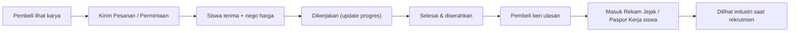

# VOC-Market — Analisis Project & Brainstorm

> **Misi:** Menghubungkan karya (barang/jasa) siswa SMK langsung ke pembeli nyata → siswa mendapat **pengalaman lapangan yang nyata & bisa dibuktikan**, dengan UI **sangat minimalis** sehingga orang yang awam teknologi pun langsung paham.

---

## 1. Ringkasan Kondisi Saat Ini

| Aspek | Kondisi |
|---|---|
| Stack | Laravel 12, Blade Components, Tailwind v4, Font Awesome. Livewire & Flowbite terpasang tapi **tidak dipakai** |
| Data | `users` (tipe `smk` / `public`), `products` (dipakai untuk 3 tipe: `product`, `service`, `portfolio`), `categories` |
| Fitur | Register/Login, feed beranda (gaya Instagram), upload Barang/Jasa/Portofolio, like, live search, profil, tombol WhatsApp |
| Style | "Chunky 3D" (border-2 + shadow bawah), 4 warna Google di tiap menu, font Poppins, teks banyak di 10–12px |
| Keamanan | Bagus untuk tahap awal: rate limiter, security headers, konversi gambar ke WebP, escape LIKE |

**Kesimpulan:** Fondasinya rapi untuk sebuah *showcase*, tapi saat ini masih **"Instagram untuk karya SMK"** — belum menjadi **"tempat siswa benar-benar bekerja untuk pelanggan nyata"**. Celah terbesar ada di sana.

---

## 2. Temuan Teknis (perlu dibereskan dulu)

### 🔴 Kritis
1. **XSS di search modal** — [search-modal.blade.php](file:///m:/DATA/Project/voc-market/resources/views/components/search-modal.blade.php#L100-L135) memasukkan `${u.name}`, `${p.name}`, `${p.author}` ke `innerHTML` tanpa escape. User yang mendaftar dengan nama `` bisa mengeksekusi script di browser pengunjung lain.
2. **Tombol "Cari" kemungkinan tidak berfungsi** — modal memakai `data-modal-toggle` milik Flowbite, tapi JS Flowbite tidak pernah dimuat (`app.js` hanya import `bootstrap`, layout hanya `@vite` CSS, `custom.js` kosong).
3. **Share link rusak** — `sharePost('{{ url()->current() }}#post-{{ $post->id }}')` padahal `<article>` tidak punya `id="post-x"`, dan tidak ada halaman detail karya.
4. **Bug like** — di [homepage.blade.php](file:///m:/DATA/Project/voc-market/resources/views/components/homepage.blade.php#L219-L238) saat *unlike*, ikon tetap merah; status like hilang setelah reload; like berbasis session sehingga bisa digelembungkan dengan menghapus cookie.

### 🟠 Tinggi
5. **Tidak ada halaman detail karya** → hasil pencarian tidak bisa diklik, tidak bisa dibagikan ke WhatsApp/sosmed dengan preview.
6. **Tidak bisa edit/hapus karya** — siswa yang salah ketik harga tidak bisa memperbaiki.
7. **Privasi anak di bawah umur** — nomor HP siswa tampil publik; NISN dikumpulkan tapi tidak dipakai/diverifikasi (relevan dengan UU PDP).
8. **Kontrol role longgar** — `/smk-users-add` tanpa `auth`; akun `public` juga bisa upload karya.
9. `views_count` tidak pernah bertambah.

### 🟡 Menengah
10. [main.blade.php](file:///m:/DATA/Project/voc-market/resources/views/components/main.blade.php) jadi "router" via `request()->is(...)` — sebaiknya tiap halaman punya view sendiri. `<title>` masih "Page Title".
11. Aset dobel/404: Font Awesome dimuat 3x (CDN CSS + CDN JS + lokal `voc-market/dist/font-awesome` yang **tidak ada**), Poppins dimuat 2x.
12. `ImageService` dipanggil tanpa `maxWidth` → foto HP 4000px disimpan utuh; berat untuk HP murah/kuota terbatas (target user awam).
13. Kolom `barcode` dipakai sebagai ID post; `type` string bebas tanpa enum.
14. Password minimum 6 karakter; README menyebut Livewire padahal tidak dipakai.

---

## 3. Brainstorm UI/UX — "Minimalis untuk Orang Awam"

### Masalah utama UI sekarang
- **Bukan minimalis**: tiap menu beda warna (biru/kuning/hijau/merah), border tebal + shadow di semua elemen → mata lelah, tidak jelas mana yang penting.
- **Teks terlalu kecil**: banyak `text-[10px]`, `text-[11px]`, `text-xs`. Orang tua/awam kesulitan membaca.
- **Navigasi mobile hanya ikon** (label `hidden lg:block`) — orang awam tidak paham arti ikon.
- **Istilah Inggris & jargon**: "Service", "Portfolio", badge `PRODUCT` huruf kapital.
- **Pola feed sosmed** (scroll satu per satu, like, share) asing bagi yang tidak main sosmed. Pola **katalog/etalase** (foto + harga + tombol) lebih universal — seperti melihat brosur.

### Prinsip desain yang diusulkan

| Prinsip | Penerapan konkret |
|---|---|
| **1 layar = 1 tujuan** | Setiap halaman punya satu tombol utama besar (mis. "Pesan Sekarang") |
| **1 warna aksen** | Basis putih/abu netral + satu warna brand (mis. hijau tua). Warna tipe karya cukup berupa titik/teks kecil |
| **Teks besar** | Body min. 16px, judul 20–24px, tombol tinggi min. 48px |
| **Selalu ada label** | Bottom nav mobile: ikon **+ teks** ("Beranda", "Cari", "Jual", "Pesanan", "Saya") |
| **Bahasa sehari-hari** | "Barang", "Jasa", "Hasil Karya"; "Hubungi Penjual" bukan "Contact" |
| **Foto dominan** | Kartu karya: foto 1:1 besar, nama 2 baris, harga tebal, nama sekolah |
| **Tanpa kejutan** | Ganti `alert()` dengan toast lembut; skeleton loading; konfirmasi sebelum aksi penting |

### Ide perbaikan per halaman
- **Beranda** → Search bar **selalu terlihat** di atas (bukan modal) + chip kategori berikon (🍰 Makanan, 🔧 Servis, 🎨 Desain, 💻 Website…) + grid 2 kolom di mobile. Section: "Terdekat dari Anda", "Baru dari SMK", "Paling Disukai".
- **Detail Karya (baru)** → galeri foto, harga, "Dibuat oleh [Siswa] · [SMK] · [Jurusan]", ulasan, tombol sticky bawah "Pesan via WhatsApp".
- **Upload Karya** → ubah jadi **wizard 3 langkah**: ① Foto (bisa langsung kamera) → ② Nama & Harga → ③ Cek & Terbitkan. Pilihan tipe digabung jadi satu pertanyaan: "Kamu mau menawarkan apa?".
- **Registrasi** → pisahkan jalur: **Pembeli tidak wajib daftar** (cukup klik WA/isi nama+HP saat pesan). Penjual (siswa) daftar bertahap: data minimum dulu, lengkapi profil belakangan dengan progress bar "Profil 60% lengkap".
- **Profil siswa** → lebih mirip **CV hidup**: statistik (pesanan selesai, rating, pelanggan), keahlian, karya, testimoni.
- **Aksesibilitas** → kontras AA, `alt` deskriptif, fokus keyboard, opsi "Teks Besar", dan **PWA** (bisa "dipasang" di layar HP seperti aplikasi).
- **Font** → pertimbangkan *Plus Jakarta Sans* (karya desainer Indonesia, modern, lebih ringan dari Poppins).

---

## 4. Brainstorm Core Features Baru

Fokus: mengubah "pamer karya" menjadi **pengalaman kerja nyata yang tercatat dan terverifikasi**.

### ⭐ Tier 1 — Inti Misi (paling berdampak)

| # | Fitur | Kenapa penting untuk misi |
|---|---|---|
| 1 | **Alur Pesanan Sederhana** — status: *Diminta → Diterima → Dikerjakan → Selesai*. WhatsApp tetap jadi kanal chat, tapi pesanan **tercatat** di platform | Tanpa pencatatan, pengalaman siswa tidak bisa dibuktikan. Ini juga melatih SOP kerja (konfirmasi, tenggat, serah terima) |
| 2 | **Ulasan & Rating dari pelanggan nyata** (hanya untuk pesanan selesai) | Bukti sosial untuk pembeli + umpan balik industri untuk siswa |
| 3 | **Paspor Kerja / CV Digital** — halaman & PDF berisi: jumlah pesanan, rating, testimoni, keahlian terbukti, diverifikasi guru. Ada QR code untuk dicek keasliannya | **Menjawab langsung masalah "belum punya pengalaman"** saat melamar kerja |
| 4 | **Guru Pembimbing & Verifikasi Sekolah** — akun guru memverifikasi siswa, meninjau karya sebelum tayang, memantau pesanan | Keamanan untuk siswa di bawah umur, menjaga kualitas, membuat pembeli percaya. Selaras dengan program **Teaching Factory (TeFa)** & PKL di SMK |
| 5 | **Halaman Detail Karya + Edit/Hapus** | Fondasi untuk semua fitur di atas |

### 🚀 Tier 2 — Penghubung ke Industri

| # | Fitur | Deskripsi |
|---|---|---|
| 6 | **Papan "Butuh Bantuan"** (Request Board) | UMKM/warga memposting kebutuhan ("Butuh logo warung", "Servis 3 motor kantor"); siswa mengajukan diri. Membalik arah: permintaan dari pasar datang ke siswa |
| 7 | **Tantangan Industri** | Perusahaan memberi *brief* proyek nyata/mini-kompetisi; pemenang mendapat sertifikat/magang. Siswa merasakan standar industri |
| 8 | **Status "Siap Kerja"** | Siswa kelas akhir/alumni mengaktifkan badge; perusahaan bisa memfilter kandidat berdasarkan jurusan, rating, dan lokasi |
| 9 | **Etalase Sekolah** | Halaman per SMK berisi seluruh karya siswanya — cocok untuk unit produksi/TeFa, juga jadi promosi sekolah |

---

## 5. Usulan Roadmap

| Fase | Isi | Hasil |
|---|---|---|
| **0 — Perbaikan** (1 minggu) | Fix XSS, search modal, like, share; halaman detail; edit/hapus; rapikan aset & routing | Aplikasi stabil & aman |
| **1 — Redesign Minimalis** (1–2 minggu) | Design system baru (1 aksen, teks besar, bottom nav berlabel), katalog grid, wizard upload, registrasi bertahap | Mudah dipakai orang awam |
| **2 — Transaksi Nyata** (2–3 minggu) | Alur pesanan, ulasan, dashboard penjual, privasi nomor HP | Pengalaman kerja mulai tercatat |
| **3 — Kepercayaan & Karier** (2–3 minggu) | Akun guru/sekolah, verifikasi, Paspor Kerja + QR, badge "Siap Kerja" | Bukti pengalaman bisa dibawa melamar kerja |
| **4 — Ekosistem** | Request board, tantangan industri, etalase sekolah, PWA | Arus permintaan dari industri |

> [!IMPORTANT]
> Pembeda utama VOC-Market dari Shopee/Instagram bukan "jualan", melainkan **"setiap transaksi = pengalaman kerja yang terverifikasi"**. Fitur #1–#4 adalah inti nilai jualnya; tanpa itu platform ini hanya menjadi etalase biasa.

